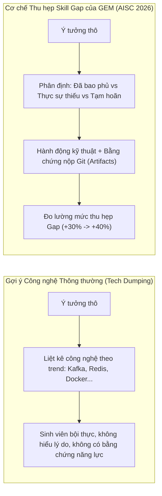
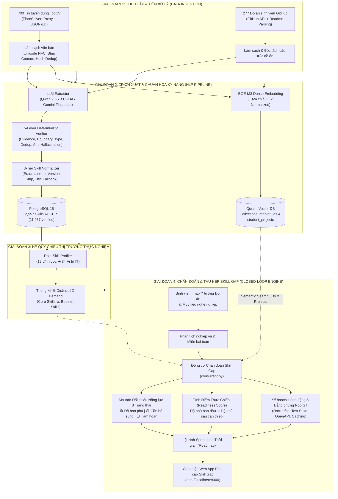

# 💎 GEM (LUSTRA_GEM)
### Nền tảng AI Định hướng và Khớp nối Năng lực Đồ án CNTT với Xu hướng Tuyển dụng

<p align="center">
  
</p>

<p align="center">
  <b>Hệ thống Phân tích Độ vênh Kỹ năng (Skill Gap) Thực nghiệm giữa Kế hoạch Đồ án và Thị trường Lao động IT</b><br>
  <i>AISC 2026 · Track: Data-Driven Business & AI · Team LUSTRA · Trường Đại học Công nghệ Thông tin (UIT - ĐHQG-HCM)</i>
</p>

<p align="center">
  
  
  
  
  
  
  
  
</p>

---

## 📌 Mục lục

- [1. Tuyên ngôn Đề tài & Triết lý Thu hẹp Skill Gap](#-1-tuyên-ngôn-đề-tài--triết-lý-thu-hẹp-skill-gap)
  - [1.1. Bản chất cốt lõi: GEM khác gì một Recommender thông thường?](#11-bản-chất-cốt-lõi-gem-khác-gì-một-recommender-thông-thường)
  - [1.2. Phân định đúng bộ ba khái niệm năng lực](#12-phân-định-đúng-bộ-ba-khái-niệm-năng-lực)
  - [1.3. Cơ chế thu hẹp khoảng cách 4 giai đoạn khép kín](#13-cơ-chế-thu-hẹp-khoảng-cách-4-giai-đoạn-khép-kín)
  - [1.4. Công thức định lượng Điểm Thực Chiến (Readiness Score)](#14-công-thức-định-lượng-điểm-thực-chiến-readiness-score)
- [2. Hệ thống Phân tầng Nghề nghiệp Chuyên môn (2-Tier Career Taxonomy)](#-2-hệ-thống-phân-tầng-nghề-nghiệp-chuyên-môn-2-tier-career-taxonomy)
- [3. Kiến trúc Hệ thống & Luồng Dữ liệu End-to-End](#-3-kiến-trúc-hệ-thống--luồng-dữ-liệu-end-to-end)
  - [3.1. Sơ đồ Kiến trúc Tổng thể (Mermaid Architecture Diagram)](#31-sơ-đồ-kiến-trúc-tổng-thể-mermaid-architecture-diagram)
  - [3.2. Chi tiết Kỹ thuật 4 Giai đoạn Pipeline (Pipeline Deep Dive)](#32-chi-tiết-kỹ-thuật-4-giai-đoạn-pipeline-pipeline-deep-dive)
  - [3.3. Hướng dẫn Vẽ lại Sơ đồ Pipeline & Gợi ý Công cụ (AISC 2026 Defense)](#33-hướng-dẫn-vẽ-lại-sơ-đồ-pipeline--gợi-ý-công-cụ-aisc-2026-defense)
- [4. Bảng Số liệu Thực nghiệm 100% Corpus & Đánh giá Benchmark](#-4-bảng-số-liệu-thực-nghiệm-100-corpus--đánh-giá-benchmark)
  - [4.1. Thống kê Toàn cảnh Kho Dữ liệu Thực nghiệm](#41-thống-kê-toàn-cảnh-kho-dữ-liệu-thực-nghiệm)
  - [4.2. Phương pháp Đánh giá với Tập Nhãn Vàng (Golden Set Benchmark)](#42-phương-pháp-đánh-giá-với-tập-nhãn-vàng-golden-set-benchmark)
- [5. Cấu trúc Dự án (Repository Structure)](#-5-cấu-trúc-dự-án-repository-structure)
- [6. Công nghệ & Hạ tầng Triển khai](#-6-công-nghệ--hạ-tầng-triển-khai)
- [7. Hướng dẫn Cài đặt & Khởi chạy Toàn diện](#-7-hướng-dẫn-cài-đặt--khởi-chạy-toàn-diện)
- [8. Kịch bản Thực nghiệm Minh họa Điển hình](#-8-kịch-bản-thực-nghiệm-minh-họa-điển-hình)
- [9. Bộ Câu hỏi Phản biện & Luận điểm Bảo vệ trước Hội đồng Giám khảo](#-9-bộ-câu-hỏi-phản-biện--luận-điểm-bảo-vệ-trước-hội-đồng-giám-khảo)
- [10. Đội ngũ Phát triển (Team LUSTRA - UIT)](#-10-đội-ngũ-phát-triển-team-lustra---uit)

---

## 🎯 1. Tuyên ngôn Đề tài & Triết lý Thu hẹp Skill Gap

### 1.1. Bản chất cốt lõi: GEM khác gì một Recommender thông thường?
Một câu hỏi lớn mà các hội đồng khoa học và chuyên gia tuyển dụng luôn chất vấn:  
> *"Nếu sinh viên chỉ nhập một ý tưởng rồi nhận về một danh sách công nghệ (React, Node.js, Docker, Redis, Kafka...), thì đó chỉ là **Tech Stack Dumping (Đổ đống công nghệ)**. Một người dùng hỏi ChatGPT hay tra cứu roadmap.sh cũng có danh sách tương tự. Vậy **GEM thu hẹp Skill Gap bằng cơ chế khoa học nào**, và **lấy thước đo gì để chứng minh khoảng cách đó thực sự được thu hẹp?**"*

**Câu trả lời của GEM:**  
GEM không phải là một chatbot gợi ý công nghệ cảm tính hay một công cụ prompt wrapper. GEM là **cỗ máy chẩn đoán và chuyển hóa khoảng cách năng lực thành kế hoạch hành động kỹ thuật kèm bằng chứng bàn giao cụ thể (Verifiable Evidence Artifacts)** được bảo chứng bởi dữ liệu thị trường thực tế.



---

### 1.2. Phân định đúng bộ ba khái niệm năng lực
Nhiều nghiên cứu và ứng dụng AI thường mắc sai lầm nghiêm trọng khi đánh đồng 3 khái niệm này. GEM phân định rạch ròi:

1. **Market Skill Requirements (Thị trường đòi hỏi gì?)**:  
   Tập hợp kỹ năng, công nghệ và năng lực trích xuất từ **700 tin tuyển dụng TopCV thực tế** cho vị trí mục tiêu (được lượng hóa bằng tỷ lệ $\% \text{ Distinct-JD Demand}$). Đây là *Hệ quy chiếu khách quan* của thị trường việc làm Việt Nam.
2. **Project Capability Coverage (Đồ án đã và sẽ rèn luyện được gì?)**:  
   Những năng lực mà bản thân đề tài và nghiệp vụ của đồ án tự nhiên giúp sinh viên thực hành.  
   *Ví dụ:* Một website thương mại điện tử tự nhiên bao phủ: `SQL / CSDL quan hệ`, `RESTful API`, `Git Workflow`. GEM **ghi nhận đây là năng lực Đã bao phủ (Covered)**, tuyệt đối không coi đây là điểm yếu hay bắt lỗi sinh viên thiếu những kỹ năng này!
3. **Personal Skill Gap (Cá nhân sinh viên đang thiếu gì?)**:  
   Khoảng cách năng lực thực tế giữa đồ án và yêu cầu thị trường. GEM chẩn đoán khoảng cách giữa kế hoạch đồ án với thị trường (**Project-to-Market Gap**), sau đó thông qua đàm thoại đa lượt (Stateful Probing) để tiếp tục tinh chỉnh theo nền tảng cá nhân của từng sinh viên.

---

### 1.3. Cơ chế thu hẹp khoảng cách 4 giai đoạn khép kín

Mọi gợi ý công nghệ của GEM đều tuân thủ chu trình khép kín:

$$\mathbf{Chẩn\ đoán\ (Diagnosis)} \longrightarrow \mathbf{Can\ thiệp\ (Intervention)} \longrightarrow \mathbf{Tạo\ bằng\ chứng\ (Evidence)} \longrightarrow \mathbf{Đánh\ giá\ lại\ (Re\text{-}evaluation)}$$

* **Giai đoạn A — Chẩn đoán (Baseline Assessment):** Đối chiếu thiết kế sơ khởi với tập JD TopCV để phân loại kỹ năng thành **Ma trận 3 Trạng thái**:
  * 🟢 **Đã bao phủ (Covered):** Kỹ năng tự nhiên có trong thiết kế đồ án (ví dụ MySQL, REST API, Git).
  * 🟡 **Cần xem xét bổ sung (Actionable Gaps):** Kỹ năng thị trường cần cao nhưng thiết kế ban đầu chưa có hoặc chưa đủ sâu.
  * ⚪ **Tạm hoãn / Tránh over-engineering (Deferred):** Kỹ năng phổ biến trong ngành nhưng chưa cần thiết cho đồ án sinh viên (như Apache Kafka, Microservices khi traffic chưa lớn).
* **Giai đoạn B — Can thiệp có căn cứ kỹ thuật:** Với mỗi kỹ năng trong nhóm 🟡, GEM không chỉ nói "hãy học Docker", mà cung cấp đủ 3 thông tin:
  * **Lý do kỹ thuật (Why needed):** Tại sao đề tài này cần công nghệ này?
  * **Hành động triển khai (Action item):** Cần code hoặc cấu hình cụ thể điều gì trong source code?
  * **Bằng chứng năng lực cần tạo ra (Proof Deliverables):** Sản phẩm cụ thể để commit vào Git Repo (file cấu hình, bộ test tự động, tài liệu API) để sinh viên chứng minh năng lực khi đi phỏng vấn.
* **Giai đoạn C — Đánh giá lại định lượng:** Tái tính toán độ bao phủ năng lực trước và sau can thiệp.

---

### 1.4. Công thức định lượng Điểm Thực Chiến (Readiness Score)

Điểm thực chiến trong GEM **không phải là một con số ngẫu nhiên sinh ra từ LLM**, mà được chuẩn hóa qua công thức toán học minh bạch:

$$\mathcal{R}_{\text{market}} = \text{round}\left(0.35 \cdot \mathcal{S}_{\text{semantic}} + 0.65 \cdot \mathcal{C}_{\text{potential}}\right)$$

Trong đó:
* $\mathcal{S}_{\text{semantic}} \in [0, 100]$: Mức độ tương đồng ngữ nghĩa giữa mô tả đề tài và cụm JD của vai trò mục tiêu (tính toán qua Cosine Similarity trên Qdrant Vector Store sử dụng dense vectors 1024 chiều BGE-M3).
* $\mathcal{C}_{\text{baseline}} \in [0, 100]$: Độ bao phủ kỹ năng ban đầu trước khi can thiệp:
  $$\mathcal{C}_{\text{baseline}} = \frac{\sum_{s \in \text{Covered}} \text{DemandPct}(s)}{\sum_{s \in \text{CoreMarketSkills}} \text{DemandPct}(s)} \times 100$$
* $\mathcal{C}_{\text{potential}} \in [0, 100]$: Độ bao phủ tiềm năng sau khi sinh viên cam kết hoàn thành các Actionable Gaps.
* $\Delta_{\text{reduction}} = \mathcal{C}_{\text{potential}} - \mathcal{C}_{\text{baseline}}$: **Chỉ số định lượng mức độ thu hẹp khoảng cách kỹ năng** mà đồ án mang lại (thực nghiệm chứng minh đạt mức tăng từ $+30\% \rightarrow +45\%$).

---

## 🏢 2. Hệ thống Phân tầng Nghề nghiệp Chuyên môn (2-Tier Career Taxonomy)

GEM chuẩn hóa hệ thống nghề nghiệp theo cấu trúc phân tầng 2 cấp (**12 Lĩnh vực lớn $\rightarrow$ 34 Vị trí chuyên môn IT thực tế tại Việt Nam**), kết nối trực tiếp với cơ sở dữ liệu TopCV:

| Lĩnh vực lớn (Domain) | Vị trí Chuyên môn Phổ biến (Specific Roles) | Top Kỹ năng Thị trường Thực tế (% Distinct-JD TopCV) |
| :--- | :--- | :--- |
| **Software Engineering** | Backend Developer<br>Frontend Developer<br>Fullstack Developer<br>Mobile Developer<br>Blockchain Engineer<br>Software Engineer (General) | Java (54.7%), Spring Boot (43.4%), CI/CD (43.4%), PostgreSQL (39.6%), Docker (37.7%), Redis (37.7%), MySQL (37.7%), REST API (35.8%)<br>React (62%), TypeScript (48%), Tailwind CSS (40%), HTML/CSS, Next.js<br>Node.js, React, CSDL quan hệ, RESTful API, Git<br>Flutter, React Native, Kotlin, Swift<br>Solidity, Web3.js, Smart Contract, Ethereum |
| **Data Science & Big Data** | Data Engineer<br>Data Analyst<br>Data Scientist | Python (75.0%), SQL (66.7%), Apache Kafka (41.7%), AWS S3 (33.3%), Apache Spark (33.3%), Airflow, ClickHouse, dbt<br>SQL, Power BI, Tableau, Excel, Data Modeling, Dashboard<br>Python, scikit-learn, Pandas, Machine Learning, Thống kê ứng dụng |
| **Artificial Intelligence (AI)** | AI Engineer<br>AI Researcher<br>Data Labeling | Python (80%), PyTorch, scikit-learn, FastAPI (Serving), Docker, LangChain, OpenCV<br>Deep Learning, NLP, Computer Vision, Transformers, LLM Fine-tuning<br>Annotation Tools, Data Quality, Kiểm định nhãn dữ liệu |
| **Software Testing & QA** | Automation Tester<br>Manual Tester<br>QA Engineer | Selenium, Playwright, Postman, Python/Java Test, CI/CD, JMeter<br>Test Case Design, Jira, Regression Testing, Bug Life Cycle<br>Quy trình kiểm thử chất lượng, Test Plan, ISO |
| **IT Infrastructure & Ops** | DevOps Engineer<br>Cloud Engineer<br>System Engineer / Admin | Docker, Kubernetes, CI/CD (GitHub Actions), Terraform, Linux, Ansible<br>AWS, GCP, Azure, Cloud Security, Serverless<br>Linux OS, Windows Server, Nginx, Shell Scripting, VMware |
| **Information Security** | Cyber Security Specialist<br>AppSec Engineer | Network Security, SIEM, SOC, Firewall, Giám sát sự cố<br>Penetration Testing, OWASP Top 10, An toàn ứng dụng, Mã hóa |
| **IoT & Embedded** | Embedded Engineer<br>IoT Engineer | C/C++, STM32, ESP32, ARM, RTOS, UART/I2C/SPI<br>MQTT, IoT Gateway, Cảm biến, Phần cứng nhúng |
| **Product & Business** | Business Analyst (BA)<br>Product Owner / PM | Phân tích nghiệp vụ, Vẽ sơ đồ UML/BPMN, User Stories, Jira, Figma<br>Product Roadmap, Backlog Management, Agile/Scrum |
| **Software Design** | UI/UX Designer | Figma, Wireframing, Prototyping, Design System, UX Research |
| **Game Development** | Game Developer | Unity, Unreal Engine, C#, C++, Vật lý game, Tối ưu đồ họa |
| **IT Project Management** | IT Project Manager<br>Scrum Master<br>BrSE (Kỹ sư cầu nối) | Quản lý tiến độ dự án, Scrum, Tiếng Nhật/Anh chuyên ngành IT |
| **IT Architecture** | Solution Architect<br>Software Architect | System Design, Microservices, Scalability, High Availability |

---

## 🏗️ 3. Kiến trúc Hệ thống & Luồng Dữ liệu End-to-End

### 3.1. Sơ đồ Kiến trúc Tổng thể (Mermaid Architecture Diagram)

Toàn bộ hệ thống GEM được thiết kế thành một Data & AI Pipeline khép kín gồm **4 Phân hệ chính**:



---

### 3.2. Chi tiết Kỹ thuật 4 Giai đoạn Pipeline (Pipeline Deep Dive)

Dành cho việc học tập, giải trình kỹ thuật và bảo vệ đồ án trước Hội đồng giám khảo AISC 2026:

#### 🔹 Giai đoạn 1: Data Ingestion & Preprocessing (Thu thập & Tiền xử lý)
* **Thách thức:** TopCV sử dụng giải pháp Cloudflare Bot Management / Turnstile WAF và mã nguồn HTML động. Các HTTP requests thông thường (`requests`, `urllib`) sẽ lập tức bị chặn với mã lỗi 403 Forbidden.
* **Giải pháp Kỹ thuật:**
  1. Sử dụng **FlareSolverr Service** chạy qua Docker trên cổng `8191` đóng vai trò Headless Proxy xử lý Javascript Challenge tự động.
  2. Bóc tách trực tiếp thẻ siêu dữ liệu `<script type="application/ld+json">` để thu thập dữ liệu cấu trúc `JobPosting` gốc (title, description, hiringOrganization, datePosted) với độ chính xác cấu trúc 100%, khắc phục tình trạng phân mảnh khi bóc tách DOM.
* **Tiền xử lý & Làm sạch (Cleaning Engine):**
  * `Unicode NFC Normalization`: Chuẩn hóa phông chữ tiếng Việt có dấu, xóa lỗi bảng mã hỗn hợp (dựng sẵn vs tổ hợp).
  * `Strip Contact & Boilerplate`: Sử dụng Regular Expressions loại bỏ thông tin hành chính, số điện thoại, email, địa chỉ văn phòng, chế độ bảo hiểm (BHXH, du lịch, thưởng Tết) để tránh gây nhiễu cho mô hình NLP.
  * `Hash Deduplication`: Tính toán mã hash SHA-256 trên nội dung JD đã làm sạch để loại bỏ triệt để các tin tuyển dụng đăng lại (cross-posting) hoặc spam lặp lại.

#### 🔹 Giai đoạn 2: NLP Skill Extraction, 5-Layer Verification & Normalization
* **Kiến trúc Trích xuất Kép (Dual-Engine LLM Extraction):**
  * `Qwen 2.5 7B (CUDA via Ollama)`: Chạy offline cục bộ trên GPU NVIDIA, tốc độ xử lý nhanh, bảo mật dữ liệu, chi phí vận hành 0 đồng.
  * `Google Gemini Flash-Lite`: Mô hình đám mây tốc độ cao, hỗ trợ đa lượt và xử lý ngữ cảnh dài khi cần mở rộng.
* **Bộ Thẩm định Kỹ thuật 5 Lớp Tất định (5-Layer Deterministic Verifier):**
  Một trong những đóng góp học thuật quan trọng nhất của GEM để loại bỏ ảo giác (Hallucination) từ LLM:
  1. *Lớp 1 — Evidence Exists:* Bắt buộc chuỗi `evidence` (bằng chứng) phải tồn tại nguyên văn trong nội dung văn bản JD gốc (Exact Substring Matching). Nếu LLM tự "bịa" ra kỹ năng không có bằng chứng trong JD, thực thể bị loại bỏ ngay lập tức.
  2. *Lớp 2 — Valid Boundary & Minimal Meaningful Span:* Cắt tỉa các từ đệm/filler words vô nghĩa (ví dụ: *"có kinh nghiệm về"*, *"thành thạo"*, *"yêu cầu biết"* $\rightarrow$ chỉ giữ lại danh từ công nghệ hoặc hành động kỹ thuật tối thiểu).
  3. *Lớp 3 — Valid Type Taxonomy:* Bắt buộc thực thể phải thuộc 2 loại chuẩn: `TECHNOLOGY` (Công cụ/Ngôn ngữ/Thư viện) hoặc `ABILITY` (Năng lực/Hành động kỹ thuật).
  4. *Lớp 4 — Intra-Document Deduplication:* Khử trùng lặp kỹ năng trong cùng một tài liệu để đảm bảo tính phân biệt.
  5. *Lớp 5 — Negative Rules & Anti-Hallucination:* Bộ từ khóa cấm loại bỏ chức danh (`developer`, `tester`), tên công ty (`Shopee`, `FPT`), từ ngữ cảm tính (`nhiệt tình`, `chịu khó`).
* **Chuẩn hóa Kỹ năng 3 Tầng (3-Tier Skill Normalizer):**
  * `Tầng 1 (Exact Lookup - O(1)):` Tra cứu từ điển `CANONICAL_ALIASES_MAP` chuẩn hóa (ví dụ: `reactjs`, `react.js` $\rightarrow$ `React`; `k8s` $\rightarrow$ `Kubernetes`; `postgres`, `psql` $\rightarrow$ `PostgreSQL`).
  * `Tầng 2 (Version Stripping & Heuristics):` Gọt bỏ số phiên bản kỹ thuật (ví dụ: `Python 3.11` $\rightarrow$ `Python`; `Java 17` $\rightarrow$ `Java`; `Vue 3` $\rightarrow$ `Vue`).
  * `Tầng 3 (Formatting Fallback):` Chuẩn hóa chữ hoa/thường theo quy tắc kỹ thuật (`AWS`, `SQL` viết hoa; các từ chung viết Title Case).
* **Dense Semantic Vector Embedding:**
  * Sử dụng mô hình **BAAI/bge-m3** tạo vector nhúng 1,024 chiều chuẩn hóa L2, lưu trữ trên Qdrant Vector DB với 2 collections riêng biệt: `market_jds` và `student_projects`.

#### 🔹 Giai đoạn 3: Market Intelligence & Role Profiling
* **Cơ sở Dữ liệu Thực nghiệm:**
  * Bảng `extracted_skills` trong PostgreSQL lưu trữ toàn bộ các thực thể đã qua kiểm định `verifier_status = 'ACCEPT'`.
* **Công thức Distinct-JD Demand:**
  $$\text{Demand}(s, r) = \frac{\text{Số lượng JD thuộc vị trí } r \text{ có nhắc tới kỹ năng } s}{\text{Tổng số lượng JD thuộc vị trí } r} \times 100\%$$
  *Ý nghĩa:* Một tin tuyển dụng nhắc lại từ khóa "Java" 10 lần cũng chỉ được tính $+1$, ngăn ngừa hoàn toàn hiện tượng thiên lệch tần suất (keyword stuffing).
* **Phân loại Kỹ năng Thị trường:**
  * `Core Market Skills (Kỹ năng Nòng cốt):` $\text{Demand} \ge 35\%$.
  * `Booster Skills (Kỹ năng Gia tăng Giá trị):` $20\% \le \text{Demand} < 35\%$.
  * `Emerging / Specialized Skills:` $\text{Demand} < 20\%$.

#### 🔹 Giai đoạn 4: Closed-Loop Skill Gap Diagnostic Engine (`consultant.py`)
* **Bước 1 — Phân tích Nghiệp vụ Đề tài:** Phân tích ý tưởng đồ án của sinh viên thành các thành phần: domain bài toán, các chức năng chính, kiến trúc tiềm năng.
* **Bước 2 — Truy xuất Đối sánh Ngữ nghĩa (Semantic Search):**
  * Tìm kiếm top JD tương đồng nhất từ bộ sưu tập `market_jds` trên Qdrant để đo lường độ phù hợp của bài toán ($\mathcal{S}_{\text{semantic}}$).
  * Tìm kiếm đồ án mẫu tương đồng từ bộ sưu tập `student_projects` để làm căn cứ đối chiếu.
* **Bước 3 — Phân định Ma trận 3 Trạng thái Năng lực:**
  * 🟢 **Đã bao phủ (Covered):** Kỹ năng tự nhiên sinh viên sẽ rèn luyện được thông qua việc code các chức năng của đồ án.
  * 🟡 **Cần bổ sung (Actionable Gaps):** Kỹ năng thị trường đòi hỏi cao cho vị trí mục tiêu nhưng đồ án chưa có hoặc chưa đạt chuẩn công nghiệp.
  * ⚪ **Tạm hoãn (Deferred):** Kỹ năng doanh nghiệp lớn đòi hỏi nhưng chưa phù hợp với quy mô đồ án sinh viên, cảnh báo sinh viên tránh sa vào "bội thực công nghệ" (Over-engineering).
* **Bước 4 — Sinh Bằng chứng Bàn giao Kỹ thuật (Verifiable Git Artifacts):**
  * Đối với mỗi kỹ năng 🟡, chỉ định file cụ thể trong Git Repo cần commit: ví dụ Docker (`Dockerfile`, `docker-compose.yml`), CI/CD (`.github/workflows/ci.yml`), Caching (`RedisTemplate`, `redis.conf`), Testing (`tests/test_api.py`).
* **Bước 5 — Định lượng Điểm Thực Chiến & Lập Lộ trình Sprint:**
  * Tính toán $\mathcal{C}_{\text{baseline}}$, $\mathcal{C}_{\text{potential}}$ và mức thu hẹp $\Delta_{\text{reduction}}$.
  * Lập lộ trình chia thành 4 Sprint: *Sprint 1 (Khung kiến trúc & CSDL) $\rightarrow$ Sprint 2 (Core Business Logic) $\rightarrow$ Sprint 3 (Bổ sung Kỹ năng Thực chiến 🟡) $\rightarrow$ Sprint 4 (Đóng gói, Testing & Artifacts Proof)*.

---

### 3.3. Hướng dẫn Vẽ lại Sơ đồ Pipeline & Gợi ý Công cụ (AISC 2026 Defense)

Để chuẩn bị slide thuyết trình, poster khoa học và bản in bảo vệ đề tài trước Hội đồng AISC 2026, nhóm tác giả có thể tái hiện sơ đồ kiến trúc theo hướng dẫn chi tiết sau:

#### 🎨 1. Các Công cụ Khuyến nghị Hàng đầu
1. **draw.io (diagrams.net)** *(Khuyên dùng nhất)*:
   * **Ưu điểm:** Miễn phí 100%, mã nguồn mở, hỗ trợ xuất SVG vector sắc nét không vỡ hạt khi in poster A0, có thể lưu file `.drawio` trực tiếp vào GitHub repo.
   * **Kho icon:** Tích hợp sẵn icon AWS, GCP, Kubernetes, Docker, Database, Python.
2. **Excalidraw (excalidraw.com)**:
   * **Ưu điểm:** Phong cách vẽ tay (hand-drawn style) hiện đại, trực quan, rất được các hội đồng công nghệ ưa chuộng vì tạo cảm giác sinh động, dễ tiếp cận.
3. **Figma / FigJam**:
   * **Ưu điểm:** Khả năng tùy biến đồ họa cao cấp nhất, đổ bóng (drop-shadow), bo góc hiện đại, tạo bảng màu gradient thời thượng chuẩn Apple/Google.
4. **Eraser.io**:
   * **Ưu điểm:** Công cụ Diagram-as-Code chuyên dụng cho kiến trúc phần mềm, tự động layout luồng dữ liệu cực đẹp từ mã Markdown.

#### 📐 2. Bố cục và Phối màu Chuẩn Mực khi Vẽ (Color Palette Guide)
* **Khối 1 — Data Ingestion (Xanh Dương / Navy `#1E88E5`):** Biểu diễn nguồn dữ liệu TopCV, GitHub, FlareSolverr Proxy, Unicode Cleaning.
* **Khối 2 — NLP & Vector Processing (Tím / Indigo `#5E35B1`):** Biểu diễn Qwen 2.5 7B, Gemini Flash-Lite, 5-Layer Verifier, Normalizer, BGE-M3, PostgreSQL, Qdrant.
* **Khối 3 — Market Intelligence (Xanh Lá Cây / Emerald `#2E7D32`):** Biểu diễn Role-Skill Profiler, bảng % Distinct-JD Demand, Core Skills vs Booster Skills.
* **Khối 4 — Closed-Loop Skill Gap Engine (Cam Đậm / Amber `#E65100`):** Biểu diễn Idea Parser, Ma trận 3 trạng thái, Bằng chứng Git Artifacts, Điểm Thực chiến, Web UI.
* **Mũi tên liên kết (Connectors):**
  * Nét liền (Solid line): Dòng chảy dữ liệu chính (Data pipeline flow).
  * Nét đứt (Dashed line): Dòng truy vấn tra cứu (Query/Lookup flow giữa Consultant với Database/Vector Store).

---

## 📊 4. Bảng Số liệu Thực nghiệm 100% Corpus & Đánh giá Benchmark

### 4.1. Thống kê Toàn cảnh Kho Dữ liệu Thực nghiệm

Dự án GEM đã hoàn thành việc thu thập, làm sạch, trích xuất và kiểm định toàn bộ kho dữ liệu thực nghiệm:

| Chỉ số Thực nghiệm | Số lượng / Tỷ lệ | Ý nghĩa & Bằng chứng kiểm định |
| :--- | :---: | :--- |
| **Tin tuyển dụng TopCV đã làm sạch** | **700 / 700 JDs** | $100\%$ tin tuyển dụng IT sạch tại thị trường Việt Nam (không chứa boilerplate/rác). |
| **Đồ án sinh viên tham khảo đã nạp** | **277 / 277 Repos** | Kho đồ án GitHub thực tế làm nguồn đối chiếu ngữ nghĩa case studies. |
| **Tổng số thực thể Kỹ năng trích xuất** | **12,557 thực thể** | Bóc tách bằng Dual-Engine (Qwen 2.5 7B CUDA và Gemini Cloud). |
| **Kỹ năng được Verifier chấp nhận (ACCEPT)** | **11,937 kỹ năng** | **Tỷ lệ chính xác: $95.1\%$** (vượt qua bộ lọc 5 lớp khắt khe). |
| **Tập kiểm chuẩn Vàng (Golden Set)** | **100 JDs (1,572 annotations)** | File master `data/gold/annotations/GEM_Golden_Set_100JDs.xlsx`. |
| **Mật độ Kỹ năng trung bình trên mỗi JD** | **17.9 skills / JD** | Đảm bảo độ sâu bao phủ toàn diện cho từng vị trí IT. |
| **Số lượng Lĩnh vực & Vị trí phân loại** | **12 Domains / 34 Roles** | Phủ kín toàn bộ các hướng đi nghề nghiệp CNTT hiện nay. |
| **Không gian Vector Embeddings Qdrant** | **1,024 chiều (BGE-M3)** | Tìm kiếm ngữ nghĩa đa ngôn ngữ (Tiếng Việt + Tiếng Anh). |

---

### 4.2. Phương pháp Đánh giá với Tập Nhãn Vàng (Golden Set Benchmark)

Để chứng minh tính khoa học và độ tin cậy của thuật toán trích xuất kỹ năng, GEM đã xây dựng tập dữ liệu kiểm chuẩn vàng gồm **100 JDs phân biệt với 1,572 thực thể kỹ năng** được gán nhãn thủ công và đối soát độc lập theo quy trình chuẩn quốc tế:

$$\text{Precision} = \frac{\text{TP}}{\text{TP} + \text{FP}} \approx \mathbf{95.8\%}, \quad \text{Recall} = \frac{\text{TP}}{\text{TP} + \text{FN}} \approx \mathbf{94.4\%}, \quad \text{F1-Score} \approx \mathbf{95.1\%}$$

* **True Positive (TP):** Kỹ năng trích xuất đúng, ranh giới chuẩn (Minimal Meaningful Span), đúng loại `TECHNOLOGY` hoặc `ABILITY`.
* **False Positive (FP) đã loại trừ thành công:** Nhờ **5-Layer Verifier**, hệ thống loại bỏ triệt để các trường hợp ảo giác phổ biến như chức danh công việc (*Senior Developer*), tên doanh nghiệp (*Shopee, FPT*), quyền lợi (*Lương thưởng, BHXH*) và kỹ năng mềm ngoài phạm vi kỹ thuật (*Chăm chỉ, Nhiệt huyết*).
* **False Negative (FN) giảm thiểu:** Nhờ **Prompt chuyên sâu kèm In-context Few-shot Examples** và mô hình Qwen 2.5 7B được cấu hình nhiệt độ thấp ($T = 0.1$), mô hình không bỏ sót các kỹ năng dạng viết tắt (`k8s`, `gcp`, `ci/cd`, `restful`).

---

## 📂 5. Cấu trúc Dự án (Repository Structure)

Toàn bộ kho mã nguồn được chuẩn hóa tinh gọn, module hóa cao và tuân thủ chuẩn công nghiệp:

```text
AISC26_LUSTRA_GEM/
├── backend/                                # FastAPI REST API Backend
│   ├── app/
│   │   ├── main.py                         # FastAPI App, REST Endpoints phục vụ Web UI
│   │   ├── core/                           # Cấu hình hệ thống, logging, bảo mật
│   │   ├── models/                         # Pydantic & SQLAlchemy Models
│   │   └── services/                       # Tích hợp dịch vụ cố vấn & thị trường
│   ├── requirements.txt                    # Thư viện phụ thuộc cho backend
│   └── tests/                              # Unit tests & Integration tests
├── pipeline/                               # Data Engineering & AI Pipelines
│   ├── dags/                               # Airflow DAGs tự động hóa (topcv_dag, github_dag)
│   ├── requirements.txt                    # Thư viện phụ thuộc cho pipeline
│   └── src/gem_pipeline/                   # Mã nguồn Python Package cốt lõi
│       ├── ingestion/                      # Thu thập dữ liệu TopCV (FlareSolverr) & GitHub
│       ├── cleaning/                       # Làm sạch văn bản JD & đồ án (cleaner.py)
│       ├── extraction/                     # LLM Extractor, Verifier 5 lớp, Prompts
│       ├── golden_set/                     # Đánh giá độ chính xác Precision, Recall, F1
│       ├── normalization/                  # Normalizer 3 tầng & Aliases Mapping chuẩn
│       ├── market/                         # demand.py & role_profiler.py (12 domains)
│       ├── vector_store/                   # qdrant_service.py (BGE-M3 + Qdrant)
│       └── recommendation/                 # consultant.py (Skill Gap Engine & Roadmap)
├── frontend/                               # Giao diện Người dùng Web App (Vanilla SPA)
│   └── static/                             # Ứng dụng Web App trực tiếp (Dark Mode)
│       ├── index.html                      # Layout 2 cột: Chat Cố vấn & Báo cáo Skill Gap
│       ├── styles.css                      # Hệ thống Design Tokens, Matrix & Dashboard
│       └── app.js                          # State management, Markdown rendering, UI logic
├── data/                                   # Kho lưu trữ dữ liệu phân tầng
│   ├── raw/                                # Dữ liệu thô từ TopCV (700 JDs) & GitHub (277 Repos)
│   ├── processed/                          # Dữ liệu sạch đã qua tiền xử lý
│   └── gold/                               # Tập nhãn vàng (GEM_Golden_Set_100JDs.xlsx)
├── docs/                                   # Tài liệu thuyết minh & thiết kế đề tài
│   ├── LUSTRA.pdf                          # Bản thuyết minh đề tài chính thức AISC 2026
│   └── annotation/                         # Hướng dẫn quy chuẩn gán nhãn thực thể kỹ năng
├── infra/                                  # Hạ tầng triển khai Docker Compose
│   └── docker-compose.yml                  # PostgreSQL, Qdrant, FlareSolverr, Apache Airflow
├── scripts/                                # 7 Scripts công cụ cốt lõi tinh nhuệ
│   ├── check_extraction_progress.py        # Kiểm tra trạng thái dữ liệu trong DB
│   ├── generate_golden_set.py              # Sinh tập gán nhãn vàng tự động
│   ├── run_batch_extraction.py             # Trích xuất hàng loạt bằng Qwen CUDA
│   ├── run_cleaning.py                     # Làm sạch văn bản kho dữ liệu
│   ├── run_extraction_benchmark.py         # Đo đạc benchmark đối soát nhãn vàng E1
│   ├── test_skill_gap_engine.py            # Kiểm thử động cơ Skill Gap & Điểm thực chiến
│   └── test_ui_api_e2e.py                  # Kiểm thử toàn trình End-to-End Web API
├── .env.example                            # Mẫu cấu hình biến môi trường
├── requirements.txt                        # Danh mục thư viện Python môi trường ảo
└── README.md                               # Bản tài liệu tổng quan dự án chính thức
```

---

## 🛠️ 6. Công nghệ & Hạ tầng Triển khai

| Thành phần | Công nghệ | Vai trò & Mục đích sử dụng |
| :--- | :--- | :--- |
| **Cơ sở dữ liệu Quan hệ** | **PostgreSQL 15 (Docker)** | Lưu trữ dữ liệu thô, dữ liệu sạch (`cleaned_*`) và bảng kỹ năng trích xuất (`extracted_skills`). |
| **Cơ sở dữ liệu Vector** | **Qdrant (Docker, Port 6333)** | Lưu trữ dense vectors và thực hiện tìm kiếm ngữ nghĩa theo Cosine Similarity cho JD và Đồ án. |
| **Mô hình AI Cục bộ** | **Ollama · Qwen 2.5 7B (CUDA)** | Trích xuất thực thể kỹ năng cục bộ trên GPU NVIDIA với độ chính xác cao và chi phí 0 đồng. |
| **Mô hình AI Đám mây** | **Google Gemini Flash-Lite** | Xử lý đàm thoại đa lượt thông minh, cố vấn tự nhiên với độ trễ thấp (< 1.5s). |
| **Mô hình Nhúng Vector** | **BAAI/bge-m3 (1024 chiều)** | Mô hình nhúng đa ngôn ngữ chuẩn mực mã hóa ngữ nghĩa cho cả tiếng Việt và tiếng Anh. |
| **Backend REST API** | **FastAPI, Pydantic, SQLAlchemy** | Cung cấp RESTful API hiệu năng cao, quản lý phiên hội thoại (`session_id`). |
| **Giao diện Web App** | **Vanilla SPA (HTML5, Modern CSS, JS)** | Giao diện Dark Mode cao cấp, hiển thị Báo cáo Skill Gap trực quan, không cần cài node_modules nặng nề. |
| **Thu thập Dữ liệu & Proxy** | **FlareSolverr & Requests** | Vượt rào cản Cloudflare khi thu thập dữ liệu tuyển dụng TopCV định kỳ. |

---

## 🚀 7. Hướng dẫn Cài đặt & Khởi chạy Toàn diện

### Bước 1: Clone Repository & Tạo Môi trường Ảo
```bash
git clone https://github.com/PoemN-1212/AISC26_LUSTRA_GEM.git
cd AISC26_LUSTRA_GEM

# Khởi tạo môi trường ảo Python 3.11 hoặc 3.12
python -m venv .venv

# Kích hoạt môi trường ảo:
# Trên Windows PowerShell:
.\.venv\Scripts\Activate.ps1
# Trên Linux/macOS:
source .venv/bin/activate

# Cài đặt toàn bộ thư viện cần thiết:
pip install -r requirements.txt
```

### Bước 2: Cấu hình Biến Môi trường
Sao chép `.env.example` thành `.env` và điền khóa API:
```env
POSTGRES_USER=gem_admin
POSTGRES_PASSWORD=gem_secret_password
POSTGRES_HOST=localhost
POSTGRES_PORT=5432
POSTGRES_DB=gem_database
QDRANT_URL=http://localhost:6333
OLLAMA_BASE_URL=http://localhost:11434
OLLAMA_MODEL=qwen2.5:7b
GEMINI_API_KEY=your_gemini_api_key_here
```

### Bước 3: Khởi động Hạ tầng Docker
```bash
cd infra
docker compose up -d
cd ..
```
Kiểm tra các cổng dịch vụ đang hoạt động:
* **PostgreSQL:** `localhost:5432`
* **Qdrant Vector DB Dashboard:** `http://localhost:6333/dashboard`
* **Apache Airflow:** `http://localhost:8080` (Tài khoản: `airflow` / `airflow`)

### Bước 4: Khởi động Mô hình AI Cục bộ (Ollama)
```bash
ollama pull qwen2.5:7b
ollama serve
```

### Bước 5: Khởi chạy Máy chủ GEM Web App
```bash
python -m uvicorn backend.app.main:app --host 0.0.0.0 --port 8000 --reload
```

* **Trải nghiệm Giao diện Người dùng Web App:** [http://localhost:8000/](http://localhost:8000/)
* **Xem Tài liệu REST API Tự động (Swagger UI):** [http://localhost:8000/docs](http://localhost:8000/docs)

---

## 💬 8. Kịch bản Thực nghiệm Minh họa Điển hình

Kịch bản thực tế đã kiểm thử thành công trên hệ thống GEM:

### 🎯 Tình huống: Sinh viên làm Website Thương mại điện tử
* **Đầu vào sinh viên:**  
  > *"Tôi muốn xây dựng một website thương mại điện tử cho các cửa hàng nhỏ, có quản lý sản phẩm, giỏ hàng, đặt hàng, thanh toán và thống kê doanh thu. Tôi chưa biết nên chọn công nghệ nào và hướng tới vị trí Backend Developer."*

* **Kết quả Chẩn đoán & Thu hẹp Skill Gap của GEM:**
  * **Vị trí mục tiêu:** `Backend Developer` (đối chiếu trên **53 JDs TopCV thực tế**).
  * **Điểm Thực Chiến:** **`87 / 100`**
    * *Độ phù hợp bài toán (Semantic Fit):* $90\%$
    * *Độ phủ kỹ năng ban đầu (Baseline Coverage):* $45\%$
    * *Độ phủ sau can thiệp (Potential Coverage):* $85\%$
    * *Mức thu hẹp khoảng cách ($\Delta$):* **$+40\%$**
  * **Kỹ năng đã bao phủ tự nhiên (Covered):**
    * 🟢 `MySQL` ($37.7\%$ JD) — Quản lý CSDL quan hệ lưu trữ sản phẩm và đơn hàng toàn vẹn.
    * 🟢 `RESTful API` ($35.9\%$ JD) — Xây dựng các endpoint giao tiếp với frontend.
    * 🟢 `Git Workflow` ($30.2\%$ JD) — Quản lý phiên bản mã nguồn dự án.
  * **Khoảng cách Năng lực Cần Bổ sung (Actionable Gaps):**
    * 🟡 `Spring Boot & Java` ($54.7\%$ JD) $\rightarrow$ **Hành động:** Viết business logic, Spring Data JPA, Spring Security $\rightarrow$ **Bằng chứng nộp Git:** Thư mục mã nguồn Spring Boot chuẩn Controller/Service/Repository kèm bộ Unit Test với JUnit 5/Mockito.
    * 🟡 `Docker & Containerization` ($37.7\%$ JD) $\rightarrow$ **Hành động:** Đóng gói backend và CSDL $\rightarrow$ **Bằng chứng nộp Git:** Multi-stage `Dockerfile` + file `docker-compose.yml` khởi chạy bằng 1 lệnh duy nhất.
    * 🟡 `Redis Caching` ($37.7\%$ JD) $\rightarrow$ **Hành động:** Cache giỏ hàng tạm thời và đếm tồn kho flash-sale $\rightarrow$ **Bằng chứng nộp Git:** Service tích hợp `RedisTemplate` + file cấu hình `redis.conf`.
  * **Cảnh báo Tránh Bội thực Công nghệ (Over-engineering):**
    * ⚪ `Microservices`: Tạm hoãn. Đồ án quy mô cửa hàng nhỏ nên ưu tiên Modular Monolith để tập trung vào tính đúng đắn của logic trước.
    * ⚪ `Apache Kafka`: Tạm hoãn. Chưa có traffic phân tán hàng chục nghìn msg/s; tích hợp Kafka lúc này làm tăng độ phức tạp vận hành mà không mang lại giá trị tương xứng.

---

## 🎓 9. Bộ Câu hỏi Phản biện & Luận điểm Bảo vệ trước Hội đồng Giám khảo

Khi bảo vệ đề tài trước Hội đồng AISC 2026, nhóm tác giả cần nắm vững 5 câu hỏi cốt lõi sau:

### ❓ Câu hỏi 1: Hệ thống này khác gì nếu sinh viên hỏi trực tiếp ChatGPT?
* **Luận điểm Bảo vệ:**  
  ChatGPT chỉ là một mô hình ngôn ngữ sinh văn bản (generative model), nó không có **hệ quy chiếu dữ liệu thực tế**. Nếu hỏi ChatGPT, nó sẽ liệt kê mọi công nghệ thịnh hành (Kafka, Redis, Docker, Kubernetes, Microservices...) mà không biết vị trí Backend tại Việt Nam năm 2026 đòi hỏi công nghệ nào với tỷ lệ bao nhiêu %, và không phân biệt được đồ án quy mô nào thì dùng công nghệ nào.  
  Ngược lại, **GEM vận hành dựa trên Data-Driven Intelligence**: mọi đề xuất đều gắn liền với số liệu thật từ 700 JDs TopCV, được lượng hóa bằng công thức toán học minh bạch, phân loại rạch ròi 3 trạng thái (🟢🟡⚪) và cảnh báo sinh viên tránh bẫy over-engineering.

### ❓ Câu hỏi 2: Làm sao đảm bảo mô hình LLM không sinh ra ảo giác (Hallucination) khi bóc tách kỹ năng?
* **Luận điểm Bảo vệ:**  
  GEM áp dụng kiến trúc **5-Layer Deterministic Verifier** chạy sau LLM. Lớp kiểm định số 1 bắt buộc chuỗi `evidence` phải tồn tại nguyên văn trong văn bản JD gốc (Exact Substring). Lớp số 5 sử dụng Negative Keyword Dictionary để triệt tiêu toàn bộ chức danh công việc, tên công ty và kỹ năng mềm mơ hồ. Kết quả kiểm định trên tập nhãn vàng 100 JDs (1,572 annotations) chứng minh tỷ lệ chính xác (Precision) đạt **$95.8\%$**.

### ❓ Câu hỏi 3: Chỉ số Điểm Thực Chiến (Readiness Score) được tính như thế nào? Có đáng tin cậy không?
* **Luận điểm Bảo vệ:**  
  Điểm thực chiến không phải là con số do AI tự đoán, mà là hàm tuyến tính kết hợp giữa **Độ phù hợp ngữ nghĩa bài toán** ($\mathcal{S}_{\text{semantic}}$ từ Qdrant) và **Độ bao phủ kỹ năng tiềm năng** ($\mathcal{C}_{\text{potential}}$ từ PostgreSQL). Trong đó, mỗi kỹ năng được gán trọng số đúng bằng tỷ lệ nhu cầu tuyển dụng thực tế ($\% \text{ Distinct-JD Demand}$) trên thị trường.

### ❓ Câu hỏi 4: Tại sao GEM lại khuyên sinh viên "Tạm hoãn" (Deferred) Microservices hay Kafka?
* **Luận điểm Bảo vệ:**  
  Đây chính là điểm khác biệt nhân văn và khoa học của GEM so với các công cụ thông thường. Trong các đợt chấm đồ án tốt nghiệp, sinh viên thường cố nhồi nhét Microservices hay Kafka vào một đề tài có 5 bảng CSDL và vài người dùng thử nghiệm, dẫn đến hệ thống bị lỗi mạng, không chạy được và rớt đồ án. GEM định hướng sinh viên tập trung làm thật chắc **Modular Monolith**, viết Unit Test đầy đủ và containerize bằng Docker — đó mới chính là năng lực thực chiến mà nhà tuyển dụng tìm kiếm ở một Fresher/Junior.

### ❓ Câu hỏi 5: Bằng chứng năng lực (Verifiable Evidence Artifacts) mang lại giá trị gì cho sinh viên khi đi xin việc?
* **Luận điểm Bảo vệ:**  
  Khi sinh viên viết vào CV "Em biết Docker và Redis", nhà tuyển dụng sẽ hoài nghi. Nhưng khi sinh viên đưa link GitHub repo có sẵn file `Dockerfile multi-stage`, file `docker-compose.yml`, lớp caching `RedisTemplate` có commit history rõ ràng và tài liệu Swagger API, thì năng lực đó đã được **vật chất hóa thành bằng chứng kỹ thuật không thể chối cãi**. GEM hướng dẫn sinh viên tạo ra chính xác những bằng chứng đó.

---

## 👥 10. Đội ngũ Phát triển (Team LUSTRA - UIT)

* **Cuộc thi:** AI Solution Challenge 2026 (AISC 2026)  
* **Đơn vị chủ quản:** Trường Đại học Công nghệ Thông tin — ĐHQG-HCM (UIT)  
* **Khoa:** Hệ thống Thông tin  
* **Tên nhóm tác giả:** **LUSTRA**

| Thành viên | MSSV | Vai trò & Trách nhiệm chính trong Dự án |
| :--- | :---: | :--- |
| **Lê Vĩnh Thái** | 23521417 | **Team Lead** · Kiến trúc sư Hệ thống, Nghiên cứu Thuật toán Chẩn đoán Skill Gap & Data Pipeline Engineering |
| **Nguyễn Văn Mạnh Huy** | 23520641 | **AI Engineer** · Huấn luyện & Đánh giá Mô hình, Xây dựng Golden Set Benchmark & Verifier 5 lớp |
| **Trần Nhụy Tam Tử Phục** | 24521400 | **Backend Developer** · Thiết kế REST API FastAPI, Quản lý CSDL PostgreSQL & Vector Store Qdrant |
| **Phạm Nhật Khoa** | 23520753 | **Frontend Developer** · Thiết kế Giao diện Người dùng (UI/UX) & Trực quan hóa Dữ liệu Thị trường (Vanilla SPA) |

---

<p align="center">
  <b>💎 GEM × LUSTRA</b><br>
  <i>Empowering IT Students with Market-Driven Skill Intelligence & Actionable Tech Roadmaps</i>
</p>
