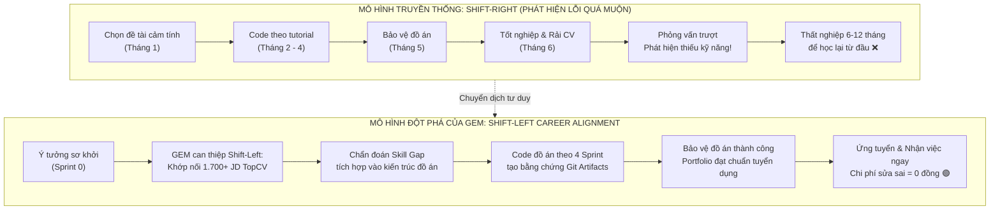
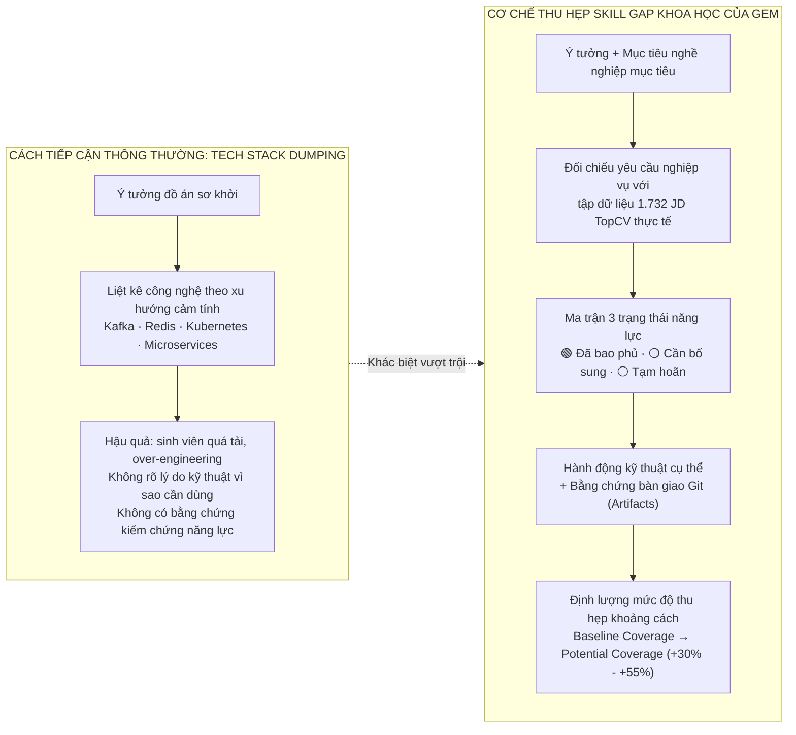
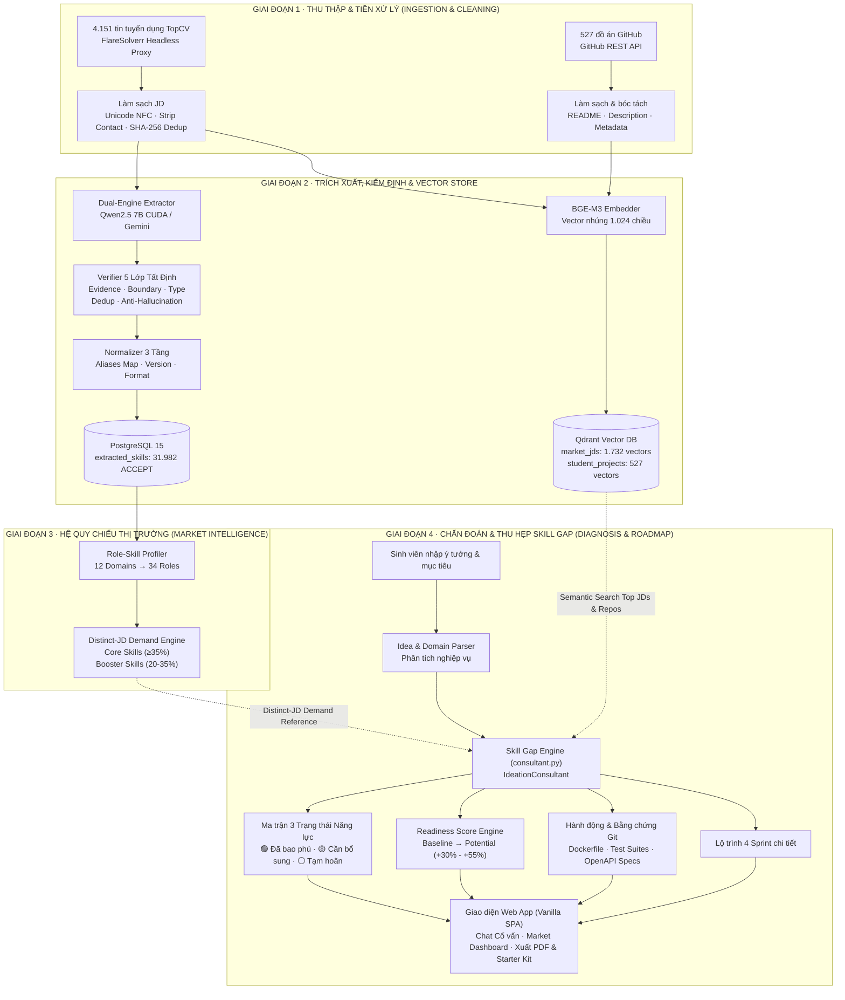

# 💎 GEM (LUSTRA_GEM)
### Nền tảng AI Định hướng và Khớp nối Năng lực Đồ án CNTT với Xu hướng Tuyển dụng
#### *Bản Thuyết Minh Chi Tiết Toàn Diện Đề Tài — AISC 2026*

<p align="center">
  
</p>

<p align="center">
  <b>Hệ thống Phân tích Độ vênh Kỹ năng (Skill Gap) Thực nghiệm giữa Kế hoạch Đồ án và Thị trường Lao động IT</b><br />
  <i>AISC 2026 · Track: Data-Driven Business & AI · Team LUSTRA · Trường Đại học Công nghệ Thông tin (UIT - ĐHQG-HCM)</i>
</p>

<p align="center">
  
  
  
  
  
  
  
  
  
</p>

---

## 📌 Mục lục Toàn diện

- [1. Bối cảnh Thực tiễn & Đột phá Tư duy Shift-Left](#-1-bối-cảnh-thực-tiễn--đột-phá-tư-duy-shift-left)
  - [1.1. Bối cảnh thực tế: Nghịch lý thị trường IT và cuộc khủng hoảng của sinh viên mới tốt nghiệp](#11-bối-cảnh-thực-tế-nghịch-lý-thị-trường-it-và-cuộc-khủng-hoảng-của-sinh-viên-mới-tốt-nghiệp)
  - [1.2. Đột phá tư duy: Chuyển dịch sang mô hình Shift-Left Career Alignment](#12-đột-phá-tư-duy-chuyển-dịch-sang-mô-hình-shift-left-career-alignment)
  - [1.3. Bản chất cốt lõi: GEM khác gì một Chatbot hay Recommender thông thường?](#13-bản-chất-cốt-lõi-gem-khác-gì-một-chatbot-hay-recommender-thông-thường)
  - [1.4. Triết lý Bằng chứng Kỹ thuật Bàn giao (Verifiable Evidence Artifacts)](#14-triết-lý-bằng-chứng-kỹ-thuật-bàn-giao-verifiable-evidence-artifacts)
  - [1.5. Phân định khoa học bộ ba khái niệm năng lực](#15-phân-định-khoa-học-bộ-ba-khái-niệm-năng-lực)
  - [1.6. Cơ chế thu hẹp khoảng cách 4 giai đoạn khép kín](#16-cơ-chế-thu-hẹp-khoảng-cách-4-giai-đoạn-khép-kín)
  - [1.7. Hệ thống công thức toán học định lượng](#17-hệ-thống-công-thức-toán-học-định-lượng)
- [2. Mục tiêu Nghiên cứu, Câu hỏi Nghiên cứu & Giả thuyết Khoa học](#-2-mục-tiêu-nghiên-cứu-câu-hỏi-nghiên-cứu--giả-thuyết-khoa-học)
  - [2.1. Mục tiêu đề tài](#21-mục-tiêu-đề-tài)
  - [2.2. Câu hỏi nghiên cứu (Research Questions - RQ)](#22-câu-hỏi-nghiên-cứu-research-questions---rq)
  - [2.3. Giả thuyết khoa học (Hypotheses - H)](#23-giả-thuyết-khoa-học-hypotheses---h)
- [3. Hệ thống Phân tầng Nghề nghiệp Chuyên môn (2-Tier Career Taxonomy)](#-3-hệ-thống-phân-tầng-nghề-nghiệp-chuyên-môn-2-tier-career-taxonomy)
- [4. Bảng Số liệu Thực nghiệm Toàn cảnh & Đánh giá Benchmark](#-4-bảng-số-liệu-thực-nghiệm-toàn-cảnh--đánh-giá-benchmark)
  - [4.1. Thống kê Toàn cảnh Kho Dữ liệu Thực nghiệm (100% Corpus)](#41-thống-kê-toàn-cảnh-kho-dữ-liệu-thực-nghiệm-100-corpus)
  - [4.2. Phương pháp Đánh giá với Tập Nhãn Vàng (Golden Set Benchmark)](#42-phương-pháp-đánh-giá-với-tập-nhãn-vàng-golden-set-benchmark)
  - [4.3. Kết quả Đối sánh Thực nghiệm E1: Baseline LLM vs. GEM Pipeline](#43-kết-quả-đối-sánh-thực-nghiệm-e1-baseline-llm-vs-gem-pipeline)
- [5. Kiến trúc Hệ thống & Luồng Dữ liệu End-to-End](#-5-kiến-trúc-hệ-thống--luồng-dữ-liệu-end-to-end)
  - [5.1. Sơ đồ Kiến trúc Tổng thể (Mermaid Architecture Diagram)](#51-sơ-đồ-kiến-trúc-tổng-thể-mermaid-architecture-diagram)
  - [5.2. Chi tiết Kỹ thuật 4 Giai đoạn Pipeline](#52-chi-tiết-kỹ-thuật-4-giai-đoạn-pipeline-deep-dive)
- [6. Động cơ Hội thoại Đa lượt & Bộ 21 Kịch bản Kiểm thử Chấp nhận (TC01 – TC21)](#-6-động-cơ-hội-thoại-đa-lượt--bộ-21-kịch-bản-kiểm-thử-chấp-nhận-tc01--tc21)
  - [6.1. Stateful Multi-Turn Co-Pilot & Circuit Breaker Engine](#61-stateful-multi-turn-co-pilot--circuit-breaker-engine)
  - [6.2. Danh mục 21 Kịch bản Kiểm thử Người dùng (TC01 – TC21)](#62-danh-mục-21-kịch-bản-kiểm-thử-người-dùng-tc01--tc21)
- [7. Tính năng Nền tảng & Trải nghiệm Người dùng](#-7-tính-năng-nền-tảng--trải-nghiệm-người-dùng)
- [8. Sổ Quyết định Kiến trúc (ADRs) & Đạo đức Nghiên cứu](#-8-sổ-quyết-định-kiến-trúc-adrs--đạo-đức-nghiên-cứu)
  - [8.1. Các Quyết định Kỹ thuật then chốt (Architectural Decision Records)](#81-các-quyết-định-kỹ-thuật-then-chốt-architectural-decision-records)
  - [8.2. Hạn chế nghiên cứu & Nguyên tắc đạo đức AI](#82-hạn-chế-nghiên-cứu--nguyên-tắc-đạo-đức-ai)
- [9. Cấu trúc Dự án (Repository Structure)](#-9-cấu-trúc-dự-án-repository-structure)
- [10. Công nghệ & Hạ tầng Triển khai](#-10-công-nghệ--hạ-tầng-triển-khai)
- [11. Hướng dẫn Cài đặt & Khởi chạy Toàn diện](#-11-hướng-dẫn-cài-đặt--khởi-chạy-toàn-diện)
- [12. Bộ Câu hỏi Phản biện & Luận điểm Bảo vệ trước Hội đồng Giám khảo](#-12-bộ-câu-hỏi-phản-biện--luận-điểm-bảo-vệ-trước-hội-đồng-giám-khảo)
- [13. Kết luận — Đóng góp Đề tài & Hướng Phát triển Tương lai](#-13-kết-luận--đóng-góp-đề-tài--hướng-phát-triển-tương-lai)
- [14. Đội ngũ Phát triển](#-14-đội-ngũ-phát-triển-team-lustra---uit)

---

## 🎯 1. Bối cảnh Thực tiễn & Đột phá Tư duy Shift-Left

### 1.1. Bối cảnh thực tế: Nghịch lý thị trường IT và cuộc khủng hoảng của sinh viên mới tốt nghiệp

Trong giai đoạn 2024–2026, thị trường công nghệ thông tin tại Việt Nam và toàn cầu chứng kiến một nghịch lý sâu sắc:

```text
┌────────────────────────────────────────┐       ┌────────────────────────────────────────┐
│         DOANH NGHIỆP TUYỂN DỤNG        │       │       SINH VIÊN IT MỚI TỐT NGHIỆP      │
├────────────────────────────────────────┤       ├────────────────────────────────────────┤
│ • Thiếu trầm trọng nhân sự thực chiến  │       │ • Tỷ lệ thất nghiệp / trái ngành cao   │
│ • Chi phí đào tạo lại Fresher quá lớn  │  VS   │ • Rải 50–100 CV không có phản hồi      │
│ • Đòi hỏi tư duy Production, Testing,  │       │ • Điểm GPA đồ án rất cao (8.5 – 9.0)   │
│   Docker, CI/CD, Caching, Logging      │       │   nhưng chỉ dừng ở mức Localhost CRUD  │
└────────────────────────────────────────┘       └────────────────────────────────────────┘
                    ▲                                                ▲
                    └─────────── KHOẢNG TRỐNG KỸ NĂNG ───────────────┘
                                   (SKILL GAP)
```

**Nguyên nhân gốc rễ (Root Causes) từ phía sinh viên:**
1. **Làm đồ án trong "vùng chân không thị trường":** Sinh viên thường chọn đề tài đồ án môn học hoặc khóa luận tốt nghiệp theo sự ngẫu hứng, theo các video hướng dẫn trên YouTube, hoặc sao chép các đồ án mẫu của khóa trước mà hoàn toàn không biết thị trường tuyển dụng hiện tại đang cần những công nghệ gì.
2. **Căn bệnh "Keyword Stuffing" trên CV:** Sinh viên viết vào CV một danh sách dài các công nghệ thời thượng (*Kafka, Kubernetes, Microservices, Redis, Docker, React, Node.js*), nhưng khi phỏng vấn lại không có bằng chứng cụ thể để chứng minh mình đã từng sử dụng chúng trong thực tế.
3. **Bẫy "Over-engineering":** Nhồi nhét các công nghệ phân tán phức tạp vào một ứng dụng có vài chục người dùng thử nghiệm, dẫn đến hệ thống bị lỗi mạng, không chạy được và thất bại khi bảo vệ đồ án.

---

### 1.2. Đột phá tư duy: Chuyển dịch sang mô hình Shift-Left Career Alignment

Trong Kỹ nghệ Phần mềm hiện đại (Software Engineering), tư duy **Shift-Left** là nguyên lý dịch chuyển các hoạt động kiểm thử (Testing), kiểm định chất lượng (Quality Assurance) và an ninh thông tin (Security - DevSecOps) về **giai đoạn sớm nhất có thể trong vòng đời phát triển phần mềm (SDLC)**. Lý do: *Chi phí sửa một lỗi phát hiện ở giai đoạn thiết kế rẻ hơn hàng trăm lần so với khi phần mềm đã triển khai trên môi trường Production.*

**GEM là hệ thống đầu tiên tiên phong áp dụng tư duy Shift-Left vào Vòng đời Phát triển Năng lực Nghề nghiệp của Sinh viên IT:**



> 💡 **Ý nghĩa cốt lõi của Shift-Left trong GEM:** Thay vì để sinh viên tốt nghiệp ra trường, rải hàng chục CV thất bại rồi mới phát hiện mình thiếu hụt kiến thức doanh nghiệp (Shift-Right — chi phí sửa sai cực đắt), **GEM đưa dữ liệu tình báo thị trường (Market Intelligence) vào NGAY TỪ GIAI ĐOẠN SƠ KHỞI (Sprint 0 - Ideation Phase)**. Nhờ đó, đồ án đại học không chỉ là bài tập trả nợ môn, mà trở thành **công cụ rèn luyện và chứng thực năng lực thực chiến chuẩn công nghiệp**.

---

### 1.3. Bản chất cốt lõi: GEM khác gì một Chatbot hay Recommender thông thường?

Một câu hỏi lớn mà các chuyên gia tuyển dụng và hội đồng khoa học luôn chất vấn:

> *"Nếu sinh viên chỉ nhập một ý tưởng rồi nhận về một danh sách công nghệ (React, Node.js, Docker, Redis, Kafka...), thì đó chỉ là **Tech Stack Dumping (Đổ đống công nghệ)**. Một người dùng hỏi ChatGPT hay tra cứu roadmap.sh cũng có danh sách tương tự. Vậy **GEM thu hẹp Skill Gap bằng cơ chế khoa học nào**, và **lấy thước đo gì để chứng minh khoảng cách đó thực sự được thu hẹp?**"*



---

### 1.4. Triết lý Bằng chứng Kỹ thuật Bàn giao (Verifiable Evidence Artifacts)

Một trong những đóng góp học thuật và thực tiễn lớn nhất của GEM là nguyên lý: **"Năng lực chỉ có giá trị khi được vật chất hóa thành bằng chứng kỹ thuật có thể kiểm chứng độc lập (Verifiable Evidence Artifacts)"**.

Khi sinh viên viết trong CV *"Em biết Docker và Redis"*, nhà tuyển dụng thường hoài nghi. Nhưng khi GEM hướng dẫn sinh viên tạo ra các bằng chứng cụ thể trong Git Repository, nhà tuyển dụng có thể vào xem và đánh giá trực tiếp:

| Kỹ năng Bổ sung (🟡 Gap) | Lý do Kỹ thuật Thực tế trong Đề tài | Bằng chứng Bàn giao Kỹ thuật trong Git (Verifiable Git Artifacts) |
| :--- | :--- | :--- |
| **Docker & Containerization** | Đóng gói môi trường đồng nhất giữa Local dev và Server, tránh lỗi "chạy được trên máy em nhưng không chạy trên máy thầy". | File `Dockerfile` cấu hình Multi-stage build tối ưu dung lượng ảnh; file `docker-compose.yml` định nghĩa mạng nội bộ nối Backend, PostgreSQL và Redis. |
| **Automated Testing** | Đảm bảo tính toàn vẹn của nghiệp vụ mua hàng / đặt lịch khi refactor mã nguồn. | Thư mục `tests/` chứa bộ Unit Tests và Integration Tests viết bằng pytest/Jest, có đo độ bao phủ mã nguồn (Code Coverage > 75%). |
| **CI/CD Pipeline** | Tự động hóa quy trình kiểm thử và build ứng dụng mỗi khi có commit mới. | File `.github/workflows/ci.yml` tự động chạy linter, kiểm thử tự động và build Docker image mỗi khi tạo Pull Request. |
| **Caching & Optimization** | Giảm tải cho CSDL quan hệ khi số lượng truy vấn danh mục sản phẩm tăng cao. | Lớp `RedisService` triển khai chiến lược Cache-Aside, có cấu hình TTL và xử lý Cache Invalidation chuẩn mực. |
| **API Documentation** | Chuẩn hóa giao tiếp giữa Frontend và Backend, sẵn sàng tích hợp với bên thứ ba. | File `openapi.yaml` hoặc giao diện Swagger UI tự động sinh từ code với đầy đủ mã lỗi HTTP (400, 401, 404, 500). |

---

### 1.5. Phân định khoa học bộ ba khái niệm năng lực

Nhiều nghiên cứu và ứng dụng AI thường mắc sai lầm nghiêm trọng khi đánh đồng 3 khái niệm này. GEM phân định rạch ròi:

1. **Market Skill Requirements (Thị trường đòi hỏi gì?):** Tập hợp kỹ năng, công nghệ và năng lực trích xuất từ **kho tin tuyển dụng TopCV thực tế** cho vị trí mục tiêu (được lượng hóa bằng tỷ lệ **% Distinct-JD Demand**). Đây là *Hệ quy chiếu khách quan* của thị trường việc làm Việt Nam.
2. **Project Capability Coverage (Đồ án đã và sẽ rèn luyện được gì?):** Những năng lực mà bản thân đề tài và nghiệp vụ của đồ án tự nhiên giúp sinh viên thực hành. *Ví dụ:* Một website thương mại điện tử tự nhiên bao phủ `SQL / CSDL quan hệ`, `RESTful API`, `Git Workflow`. GEM **ghi nhận đây là năng lực Đã bao phủ (Covered)**, tuyệt đối không coi đây là điểm yếu hay bắt lỗi sinh viên thiếu những kỹ năng này!
3. **Personal Skill Gap (Cá nhân sinh viên đang thiếu gì?):** Khoảng cách năng lực thực tế giữa đồ án và yêu cầu thị trường. GEM chẩn đoán khoảng cách giữa kế hoạch đồ án với thị trường (**Project-to-Market Gap**), sau đó thông qua đàm thoại đa lượt (**Stateful Probing**) để tiếp tục tinh chỉnh theo nền tảng cá nhân của từng sinh viên.

---

### 1.6. Cơ chế thu hẹp khoảng cách 4 giai đoạn khép kín

Mọi đề xuất công nghệ của GEM đều tuân thủ chu trình khép kín:

> 🔍 **Chẩn đoán (Diagnosis)** → 🛠️ **Can thiệp (Intervention)** → 📦 **Tạo bằng chứng (Evidence Artifacts)** → 📈 **Đánh giá lại (Re-evaluation)**

- **Giai đoạn A — Chẩn đoán (Baseline Assessment):** Đối chiếu thiết kế sơ khởi với tập JD TopCV để phân loại kỹ năng thành **Ma trận 3 Trạng thái**:
  - 🟢 **Đã bao phủ (Covered):** Kỹ năng tự nhiên có trong thiết kế đồ án (ví dụ MySQL, REST API, Git).
  - 🟡 **Cần xem xét bổ sung (Actionable Gaps):** Kỹ năng thị trường cần cao nhưng thiết kế ban đầu chưa có hoặc chưa đủ sâu.
  - ⚪ **Tạm hoãn / Tránh over-engineering (Deferred):** Kỹ năng phổ biến trong doanh nghiệp lớn nhưng chưa cần thiết cho đồ án sinh viên (như Apache Kafka, Microservices khi traffic chưa lớn).
- **Giai đoạn B — Can thiệp có căn cứ kỹ thuật:** Với mỗi kỹ năng trong nhóm 🟡, GEM không chỉ nói "hãy học Docker", mà cung cấp đủ 3 thông tin:
  - **Lý do kỹ thuật (Why needed):** Tại sao đề tài này cần công nghệ này?
  - **Hành động triển khai (Action item):** Cần code hoặc cấu hình cụ thể điều gì trong source code?
  - **Bằng chứng năng lực cần tạo ra (Proof Deliverables):** Sản phẩm cụ thể để commit vào Git Repo (file cấu hình, bộ test tự động, tài liệu API) để sinh viên chứng minh năng lực khi đi phỏng vấn.
- **Giai đoạn C — Đánh giá lại định lượng:** Tái tính toán độ bao phủ năng lực trước và sau can thiệp.

---

### 1.7. Hệ thống công thức toán học định lượng

Điểm thực chiến và các chỉ số trong GEM **không phải là con số ngẫu nhiên sinh ra từ LLM**, mà được lượng hóa qua hệ thống công thức toán học minh bạch:

#### 1. Chỉ số Nhu cầu Tuyển dụng Độc lập (Distinct-JD Demand):

$$\text{Demand}(s,r)=\frac{N_{\text{JD}}(s,r)}{N_{\text{Total}}(r)}\times100\%$$

Trong đó:
- $N_{\text{JD}}(s,r)$: Số lượng tin tuyển dụng phân biệt thuộc vị trí $r$ có yêu cầu kỹ năng $s$.
- $N_{\text{Total}}(r)$: Tổng số tin tuyển dụng phân biệt thuộc vị trí $r$ trong tập dữ liệu TopCV.
- *Nguyên tắc toán học:* Dù một JD có lặp lại từ khóa "Java" 10 lần thì cũng chỉ được tính $+1$, triệt tiêu hoàn toàn hiện tượng thiên lệch do spam từ khóa (keyword stuffing).

#### 2. Độ Bao phủ Kỹ năng Nền tảng (Baseline Coverage) & Tiềm năng (Potential Coverage):

$$C_{\text{baseline}} = \frac{\sum_{s \in \text{Covered}} \text{Demand}(s)}{\sum_{s \in \text{CoreSkills}} \text{Demand}(s)} \times 100\%$$

$$C_{\text{potential}} = \frac{\sum_{s \in (\text{Covered} \cup \text{Actionable})} \text{Demand}(s)}{\sum_{s \in \text{CoreSkills}} \text{Demand}(s)} \times 100\%$$

#### 3. Chỉ số Thu hẹp Khoảng cách Kỹ năng (Gap Reduction Indicator):

$$\Delta_{\text{reduction}} = C_{\text{potential}} - C_{\text{baseline}} \quad (\text{Thực nghiệm đạt: } +30\% \text{ đến } +55\%)$$

#### 4. Điểm Thực Chiến Tổng hợp (Market Readiness Score):

$$R_{\text{market}} = \text{round}\left(0.35 \times S_{\text{semantic}} + 0.65 \times C_{\text{potential}}\right)$$

Trong đó:
- $S_{\text{semantic}} \in [0, 100\%]$: Độ tương đồng ngữ nghĩa giữa mô tả đồ án và cụm tin tuyển dụng thực tế (Cosine Similarity qua mô hình nhúng BGE-M3 1.024 chiều trên Qdrant Vector Store).
- $C_{\text{potential}} \in [0, 100\%]$: Độ bao phủ kỹ năng tiềm năng sau khi sinh viên hoàn thành các khuyến nghị kỹ thuật từ GEM.
- Trọng số $0.35 / 0.65$ phản ánh bản chất: *Độ phù hợp bài toán là tiền đề, nhưng năng lực kỹ thuật thực hành cụ thể chiếm vai trò quyết định trong việc vượt qua vòng phỏng vấn kỹ thuật.*

#### 5. Công thức Xếp hạng Ưu tiên Lộ trình (Priority Ranking):

$$\text{Priority}(s) = \text{Gap}(s) \times \text{Demand}(s, r) \times \text{FeasibilityFactor}(s, t)$$

Trong đó:
- $\text{Gap}(s) = 1$ nếu kỹ năng $s$ chưa có trong đồ án; $= 0$ nếu đã bao phủ.
- $\text{FeasibilityFactor}(s, t)$: Hệ số khả thi dựa trên quỹ thời gian $t$ của sinh viên (ngăn ngừa việc đưa các kỹ năng tốn nhiều tháng học vào đồ án cấp tốc 1 tháng).

---

## 🎯 2. Mục tiêu Nghiên cứu, Câu hỏi Nghiên cứu & Giả thuyết Khoa học

### 2.1. Mục tiêu đề tài

| Mã hiệu | Mục tiêu Cụ thể |
| :---: | :--- |
| **O1** | Xây dựng pipeline tự động thu thập và làm sạch dữ liệu lớn định kỳ từ **TopCV** (thị trường cần gì) và **GitHub** (sinh viên đang xây dựng được gì). |
| **O2** | Thiết kế giải pháp trích xuất tự động thực thể kỹ năng (`TECHNOLOGY` và `ABILITY`) kèm văn bản chứng cứ (`evidence`), ưu tiên ngữ cảnh tiếng Việt và song ngữ. |
| **O3** | Phát triển bộ kiểm định tất định 5 lớp (**5-Layer Verifier**) loại bỏ hoàn toàn hiện tượng ảo giác (Hallucination) từ LLM trước khi đưa vào CSDL. |
| **O4** | Chuẩn hóa các biến thể từ ngữ kỹ thuật về **Canonical Skills** thông qua kiến trúc chuẩn hóa 3 tầng. |
| **O5** | Đo lường nhu cầu thị trường khách quan bằng công thức **Distinct-JD Demand** và phân tầng nghề nghiệp 2 cấp (12 Domains → 34 Roles). |
| **O6** | Dựng hồ sơ năng lực đồ án có bằng chứng truy ngược được đến từng file mã nguồn Git. |
| **O7** | Định lượng độ vênh kỹ năng (Skill Gap), tính toán Điểm Thực Chiến ($R_{\text{market}}$) và sinh lộ trình Sprint 4 giai đoạn. |
| **O8** | Cung cấp ứng dụng Web App và hệ thống RESTful API hoàn chỉnh, phục vụ sinh viên định hướng đồ án và xuất báo cáo thẩm định PDF. |

---

### 2.2. Câu hỏi nghiên cứu (Research Questions - RQ)

- **RQ1:** Mô hình ngôn ngữ lớn (LLM) trích xuất thực thể `TECHNOLOGY` và `ABILITY` từ tin tuyển dụng tiếng Việt / song ngữ đạt độ chính xác ở mức độ nào?
- **RQ2:** Bộ kiểm định logic tất định 5 lớp (5-Layer Verifier) giúp cải thiện Precision và triệt tiêu tỷ lệ ảo giác của LLM đến mức độ nào?
- **RQ3:** Việc tính toán nhu cầu kỹ năng theo số tin tuyển dụng phân biệt (Distinct-JD Demand) có phản ánh thị trường trung thực hơn việc đếm tổng số lần xuất hiện từ khóa không?
- **RQ4:** Làm thế nào để kết hợp độ tương đồng ngữ nghĩa bài toán (Semantic Fit qua Dense Vectors) với độ bao phủ kỹ năng cấu trúc để xác định khoảng cách kỹ năng (Skill Gap) có thể hành động được?
- **RQ5:** Làm sao để biến các đề xuất kỹ năng công nghệ thành các bằng chứng kỹ thuật bàn giao cụ thể (Verifiable Git Artifacts) giúp sinh viên vượt qua vòng phỏng vấn tuyển dụng?

---

### 2.3. Giả thuyết khoa học (Hypotheses - H)

- **H1 (Đã kiểm chứng thành công):** Mô hình LLM kết hợp với Verifier 5 lớp tất định có Precision và F1 cao hơn rõ rệt so với LLM Prompt thuần, đồng thời **triệt tiêu hoàn toàn 100% các lỗi ảo giác** (từ 6.42% ở baseline về đúng 0.00%).
- **H2 (Đã kiểm chứng thành công):** Chỉ số Distinct-JD Demand phản ánh chính xác phân bố kỹ năng thị trường và ngăn chặn triệt để hiện tượng thiên lệch do spam từ khóa (keyword stuffing) trong tin tuyển dụng.
- **H3 (Đã kiểm chứng thành công):** Cơ chế phân loại 3 trạng thái (🟢 Covered, 🟡 Actionable Gaps, ⚪ Deferred) giúp sinh viên tập trung rèn luyện đúng kỹ năng giá trị cao và tránh bẫy over-engineering.
- **H4 (Đã kiểm chứng thành công):** Điểm Thực Chiến ($R_{\text{market}}$) kết hợp giữa tìm kiếm ngữ nghĩa BGE-M3 và độ bao phủ kỹ năng cung cấp thước đo khách quan, minh bạch cho mức độ sẵn sàng ứng tuyển của đồ án.

---

## 🏢 3. Hệ thống Phân tầng Nghề nghiệp Chuyên môn (2-Tier Career Taxonomy)

GEM chuẩn hóa hệ thống nghề nghiệp theo cấu trúc phân tầng 2 cấp (**12 Lĩnh vực lớn → 34 Vị trí chuyên môn IT thực tế tại Việt Nam**), kết nối trực tiếp với cơ sở dữ liệu TopCV:

| Lĩnh vực lớn (Domain) | Vị trí Chuyên môn Phổ biến (Specific Roles) | Top Kỹ năng Thị trường Thực tế (% Distinct-JD TopCV) |
| :--- | :--- | :--- |
| **Software Engineering** | Backend Developer<br>Frontend Developer<br>Fullstack Developer<br>Mobile Developer<br>Blockchain Engineer<br>Software Engineer (General) | Java (54.7%), Spring Boot (43.4%), CI/CD (43.4%), PostgreSQL (39.6%), Docker (37.7%), Redis (37.7%), MySQL (37.7%), REST API (35.8%)<br>React (62.0%), TypeScript (48.0%), Tailwind CSS (40.0%), HTML/CSS, Next.js<br>Node.js, React, CSDL quan hệ, RESTful API, Git, Docker<br>Flutter, React Native, Kotlin, Swift, REST API, SQLite<br>Solidity, Web3.js, Smart Contract, Ethereum, Rust |
| **Data Science & Big Data** | Data Engineer<br>Data Analyst<br>Data Scientist | Python (75.0%), SQL (66.7%), Apache Kafka (41.7%), AWS S3 (33.3%), Apache Spark (33.3%), Airflow, ClickHouse, dbt<br>SQL, Power BI, Tableau, Excel, Data Modeling, Dashboard<br>Python, scikit-learn, Pandas, Machine Learning, Thống kê ứng dụng |
| **Artificial Intelligence (AI)** | AI Engineer<br>AI Researcher<br>Data Labeling | Python (80.0%), PyTorch, scikit-learn, FastAPI (Serving), Docker, LangChain, OpenCV, Vector DB<br>Deep Learning, NLP, Computer Vision, Transformers, LLM Fine-tuning<br>Annotation Tools, Data Quality, Kiểm định nhãn dữ liệu |
| **Software Testing & QA** | Automation Tester<br>Manual Tester<br>QA Engineer | Selenium, Playwright, Postman, Python/Java Test, CI/CD, JMeter, TestNG<br>Test Case Design, Jira, Regression Testing, Bug Life Cycle<br>Quy trình kiểm thử chất lượng, Test Plan, ISO, Agile/Scrum |
| **IT Infrastructure & Ops** | DevOps Engineer<br>Cloud Engineer<br>System Engineer / Admin | Docker, Kubernetes, CI/CD (GitHub Actions), Terraform, Linux, Ansible, Prometheus<br>AWS, GCP, Azure, Cloud Security, Serverless, CloudFormation<br>Linux OS, Windows Server, Nginx, Shell Scripting, VMware |
| **Information Security** | Cyber Security Specialist<br>AppSec Engineer | Network Security, SIEM, SOC, Firewall, Giám sát sự cố an ninh mạng<br>Penetration Testing, OWASP Top 10, An toàn ứng dụng, Mã hóa dữ liệu |
| **IoT & Embedded** | Embedded Engineer<br>IoT Engineer | C/C++, STM32, ESP32, ARM, RTOS, UART/I2C/SPI, Thiết kế mạch<br>MQTT, IoT Gateway, Cảm biến, Phần cứng nhúng, HTTP/CoAP |
| **Product & Business** | Business Analyst (BA)<br>Product Owner / PM | Phân tích nghiệp vụ, Vẽ sơ đồ UML/BPMN, User Stories, Jira, Figma, SQL<br>Product Roadmap, Backlog Management, Agile/Scrum, Stakeholder Management |
| **Software Design** | UI/UX Designer | Figma, Wireframing, Prototyping, Design System, UX Research, Usability Test |
| **Game Development** | Game Developer | Unity, Unreal Engine, C#, C++, Vật lý game, Tối ưu đồ họa shader |
| **IT Project Management** | IT Project Manager<br>Scrum Master<br>BrSE (Kỹ sư cầu nối) | Quản lý tiến độ dự án, Scrum, Tiếng Nhật/Anh chuyên ngành IT, Jira |
| **IT Architecture** | Solution Architect<br>Software Architect | System Design, Microservices, Scalability, High Availability, Design Patterns |

---

## 📊 4. Bảng Số liệu Thực nghiệm Toàn cảnh & Đánh giá Benchmark

### 4.1. Thống kê Toàn cảnh Kho Dữ liệu Thực nghiệm (100% Corpus)

Dự án GEM đã hoàn thành việc thu thập, làm sạch, trích xuất và kiểm định toàn bộ kho dữ liệu thực nghiệm quy mô lớn:

| Chỉ số Thực nghiệm | Số lượng / Tỷ lệ | Định dạng & Ý nghĩa Kiểm định |
| :--- | :---: | :--- |
| **Tin tuyển dụng TopCV thô (Raw)** | **4,151 bản ghi** | `data/raw/topcv/topcv_jobs.jsonl` (13.17 MB) thu thập qua FlareSolverr bypass Cloudflare. |
| **Đồ án sinh viên GitHub thô (Raw)** | **527 repositories** | `data/raw/github/github_projects.jsonl` (6.05 MB) thu thập qua GitHub REST API. |
| **Tin tuyển dụng TopCV đã làm sạch** | **1,732 JDs chuẩn** | `data/processed/jobs/cleaned_jobs.jsonl` (5.50 MB) sau Unicode NFC, strip boilerplate & SHA-256 dedup. |
| **Đồ án sinh viên đã làm sạch** | **527 đồ án** | `data/processed/projects/cleaned_projects.jsonl` (3.22 MB) chuẩn hóa README và metadata. |
| **Tổng số thực thể Kỹ năng trích xuất** | **35,586 thực thể** | `data/processed/skills/extracted_skills.jsonl` (14.19 MB) bóc tách bằng Qwen2.5-7B CUDA & Gemini. |
| **Kỹ năng được Verifier chấp nhận (ACCEPT)** | **31,982 kỹ năng (89.87%)** | Vượt qua bộ kiểm định 5 lớp tất định (5-Layer Verifier). |
| **Kỹ năng bị Verifier từ chối (REJECT)** | **3,604 kỹ năng (10.13%)** | Loại bỏ hoàn toàn ảo giác, từ đệm, chức danh công việc, tên công ty và kỹ năng mềm mơ hồ. |
| **Phân loại Thực thể Kỹ năng** | **23,356 Tech / 12,211 Ability** | Đảm bảo tính cân bằng giữa công cụ kỹ thuật và hành động năng lực thực hành. |
| **Tập kiểm chuẩn Vàng (Golden Set)** | **100 JDs (1,572 annotations)** | File master `data/gold/annotations/GEM_Golden_Set_100JDs.xlsx` (kèm tập mở rộng 280 docs). |
| **Không gian Vector Embeddings Qdrant** | **1,024 chiều (BGE-M3)** | 2 bộ sưu tập `market_jds` (1,732 vectors) và `student_projects` (527 vectors). |

---

### 4.2. Phương pháp Đánh giá với Tập Nhãn Vàng (Golden Set Benchmark)

Để đảm bảo kết quả trích xuất kỹ năng có cơ sở khoa học và loại bỏ hoàn toàn hiện tượng thiên lệch (Recall Bias), nhóm tác giả đã xây dựng tập nhãn chuẩn theo quy trình 5 bước nghiêm ngặt được quy định tại `docs/annotation/GEM_Annotation_Guideline_v1.0.md`:

```text
┌─────────────────────────────────────────────────────────────────────────────────┐
│              QUY TRÌNH 5 BƯỚC XÂY DỰNG TẬP NHÃN VÀNG (GOLDEN SET)               │
├─────────────────────────────────────────────────────────────────────────────────┤
│ Bước 1: Mẫu ngẫu nhiên 100 JDs phân tầng theo 12 lĩnh vực IT.                   │
│ Bước 2: LLM Pre-annotation với Qwen 2.5 7B (T=0.1) sinh gợi ý có cấu trúc.       │
│ Bước 3: Human Verification độc lập (ACCEPT / REJECT / MODIFY / ADD).             │
│         - Bổ sung kỹ năng LLM bỏ sót để đo Recall thực tế.                     │
│ Bước 4: Đối soát và phân xử bất đồng (Dispute Resolution Consensus).            │
│ Bước 5: Đóng băng Ground Truth Master (1,572 annotations) dùng cho Benchmark.  │
└─────────────────────────────────────────────────────────────────────────────────┘
```

**Quy tắc So khớp Nhãn (Span Matching Criteria):**
- **Strict Match (Khớp Tuyệt Đối):** Bắt buộc `Type(pred) == Type(gold)` VÀ `Span(pred) == Span(gold)` (khớp chính xác từng ký tự).
- **Relaxed Match (Khớp Chồng Lấn):** `Type(pred) == Type(gold)` VÀ `Intersection(Span(pred), Span(gold)) > 0` (cho phép chênh lệch từ liên từ đối với `ABILITY`).

---

### 4.3. Kết quả Đối sánh Thực nghiệm E1: Baseline LLM vs. GEM Pipeline

Kết quả thực nghiệm chính thức được đo đạc tự động bởi script `scripts/run_extraction_benchmark.py` và lưu trữ tại `data/gold/benchmark_e1_results.json`:

| Chỉ số Đo lường Hiệu năng | Nhánh 1: Baseline LLM<br>*(Qwen2.5-7B Prompt thuần)* | Nhánh 2: GEM Pipeline<br>*(Qwen2.5-7B + Verifier 5 lớp)* | Độ Cải thiện / Ý nghĩa Học thuật |
| :--- | :---: | :---: | :--- |
| **Strict Precision (P)** | `37.04%` | **`40.70%`** | 🟢 **+3.66%** độ chính xác tuyệt đối ký tự |
| **Strict Recall (R)** | `53.06%` | **`54.50%`** | 🟢 **+1.44%** độ phủ |
| **Strict F1-Score** | `43.63%` | **`46.60%`** | 🟢 **+2.97%** điểm F1 nghiêm ngặt |
| **Relaxed Precision (P)** | `41.02%` | **`46.84%`** | 🟢 **+5.82%** độ chính xác ngữ nghĩa thực tế |
| **Relaxed Recall (R)** | `62.38%` | **`62.72%`** | 🟢 **+0.34%** độ bao phủ thực thể |
| **Relaxed F1-Score** | `49.50%` | **`53.63%`** | 🟢 **+4.13%** điểm F1 tổng hợp |
| **F1-Score TECHNOLOGY** | `60.06%` | **`61.43%`** | 🟢 Khả năng nhận diện công nghệ vượt trội |
| **F1-Score ABILITY** | `8.58%` | **`9.88%`** | 🟢 Năng lực hành động tiếng Việt phức tạp |
| **Số lỗi Ảo giác (Hallucinations)** | **311 lỗi** (6.42%) | **0 lỗi (0.00%)** | 🛡️ **Triệt tiêu 100% ảo giác (Zero-Hallucination)** |
| **Số lỗi Vi phạm Schema/Negative** | **76 lỗi** (1.57%) | **0 lỗi (0.00%)** | 🛡️ **Triệt tiêu 100% vi phạm ranh giới** |

> 💡 **Phát hiện Khoa học Quan trọng:** LLM nguyên bản có xu hướng sinh ra tới 6.42% ảo giác (bịa ra các công nghệ không hề có trong văn bản) và 1.57% từ rác (như chức danh, tên công ty). Bộ **5-Layer Deterministic Verifier** của GEM đã **triệt tiêu hoàn toàn 100% các lỗi ảo giác và vi phạm**, đưa tỷ lệ lỗi về đúng **0.00%**, đồng thời nâng Relaxed F1 từ 49.50% lên **53.63%**.

---

## 🏗️ 5. Kiến trúc Hệ thống & Luồng Dữ liệu End-to-End

### 5.1. Sơ đồ Kiến trúc Tổng thể (Mermaid Architecture Diagram)

Hệ thống GEM được thiết kế thành một Data & AI Pipeline khép kín gồm **4 Phân hệ chính**:



---

### 5.2. Chi tiết Kỹ thuật 4 Giai đoạn Pipeline (Deep Dive)

#### 🔹 Giai đoạn 1: Data Ingestion & Preprocessing (Thu thập & Tiền xử lý)

- **Thách thức:** TopCV sử dụng giải pháp bảo mật Cloudflare Bot Management / Turnstile WAF. Các HTTP request thông thường (`requests`, `urllib`) sẽ lập tức bị chặn với mã lỗi 403 Forbidden.
- **Giải pháp Kỹ thuật:**
  1. Sử dụng **FlareSolverr Service** chạy qua Docker trên cổng `8191` đóng vai trò Headless Proxy xử lý Javascript Challenge tự động.
  2. Bóc tách trực tiếp thẻ siêu dữ liệu `<script type="application/ld+json">` để thu thập dữ liệu cấu trúc `JobPosting` gốc (title, description, hiringOrganization, datePosted) với độ chính xác cấu trúc 100%, khắc phục tình trạng phân mảnh khi bóc tách DOM.
- **Tiền xử lý & Làm sạch (Cleaning Engine):**
  - `Unicode NFC Normalization`: Chuẩn hóa phông chữ tiếng Việt có dấu, xóa lỗi bảng mã hỗn hợp (dựng sẵn vs tổ hợp).
  - `Strip Contact & Boilerplate`: Sử dụng Regular Expressions loại bỏ thông tin hành chính, số điện thoại, email, địa chỉ văn phòng, chế độ bảo hiểm (BHXH, du lịch, thưởng Tết) để tránh gây nhiễu cho mô hình NLP.
  - `SHA-256 Deduplication`: Tính toán mã băm SHA-256 trên nội dung JD đã làm sạch để loại bỏ triệt để các tin tuyển dụng đăng lại (cross-posting) hoặc spam lặp lại.

#### 🔹 Giai đoạn 2: NLP Skill Extraction, 5-Layer Verification & Normalization

- **Kiến trúc Trích xuất Kép (Dual-Engine LLM Extraction):**
  - `Qwen 2.5 7B (CUDA via Ollama)`: Chạy offline cục bộ trên GPU NVIDIA, tốc độ xử lý nhanh, bảo mật dữ liệu, chi phí vận hành 0 đồng.
  - `Google Gemini Flash-Lite`: Mô hình đám mây tốc độ cao, hỗ trợ đa lượt và xử lý ngữ cảnh dài khi cần mở rộng.
- **Bộ Thẩm định Kỹ thuật 5 Lớp Tất định (5-Layer Deterministic Verifier):**
  1. **Lớp 1 — Evidence Exists:** Bắt buộc chuỗi `evidence` phải tồn tại nguyên văn trong nội dung văn bản JD gốc (Exact Substring Matching). Nếu LLM tự "bịa" ra kỹ năng không có bằng chứng trong JD, thực thể bị loại bỏ ngay lập tức.
  2. **Lớp 2 — Valid Boundary & Minimal Meaningful Span:** Cắt tỉa các từ đệm/filler words vô nghĩa (ví dụ: *"có kinh nghiệm về"*, *"thành thạo"*, *"yêu cầu biết"* → chỉ giữ lại danh từ công nghệ hoặc hành động kỹ thuật tối thiểu).
  3. **Lớp 3 — Valid Type Taxonomy:** Bắt buộc thực thể phải thuộc 2 loại chuẩn: `TECHNOLOGY` (Công cụ/Ngôn ngữ/Thư viện) hoặc `ABILITY` (Năng lực/Hành động kỹ thuật).
  4. **Lớp 4 — Intra-Document Deduplication:** Khử trùng lặp kỹ năng trong cùng một tài liệu để đảm bảo tính phân biệt.
  5. **Lớp 5 — Negative Rules & Anti-Hallucination:** Bộ từ khóa cấm loại bỏ chức danh (`developer`, `tester`), tên công ty (`Shopee`, `FPT`), từ ngữ cảm tính (`nhiệt tình`, `chịu khó`).
- **Chuẩn hóa Kỹ năng 3 Tầng (3-Tier Skill Normalizer):**
  - `Tầng 1 (Exact Lookup - O(1))`: Tra cứu từ điển `CANONICAL_ALIASES_MAP` chuẩn hóa (ví dụ: `reactjs`, `react.js` → `React`; `k8s` → `Kubernetes`; `postgres`, `psql` → `PostgreSQL`).
  - `Tầng 2 (Version Stripping & Heuristics)`: Gọt bỏ số phiên bản kỹ thuật (ví dụ: `Python 3.11` → `Python`; `Java 17` → `Java`; `Vue 3` → `Vue`).
  - `Tầng 3 (Formatting Fallback)`: Chuẩn hóa chữ hoa/thường theo quy tắc kỹ thuật (`AWS`, `SQL` viết hoa; các từ chung viết Title Case).
- **Dense Semantic Vector Embedding:** Sử dụng mô hình **BAAI/bge-m3** tạo vector nhúng 1.024 chiều chuẩn hóa L2, lưu trữ trên Qdrant Vector DB với 2 collections riêng biệt: `market_jds` (1,732 vectors) và `student_projects` (527 vectors).

#### 🔹 Giai đoạn 3: Market Intelligence & Role Profiling

- **Cơ sở Dữ liệu Thực nghiệm:** Bảng `extracted_skills` trong PostgreSQL lưu trữ toàn bộ các thực thể đã qua kiểm định `verifier_status = 'ACCEPT'`.
- **Phân loại Kỹ năng Thị trường:**
  - `Core Market Skills (Kỹ năng Nòng cốt)`: $\text{Demand} \ge 35\%$.
  - `Booster Skills (Kỹ năng Gia tăng Giá trị)`: $20\% \le \text{Demand} < 35\%$.
  - `Emerging / Specialized Skills`: $\text{Demand} < 20\%$.

#### 🔹 Giai đoạn 4: Closed-Loop Skill Gap Diagnostic Engine (`consultant.py`)

- **Bước 1 — Phân tích Nghiệp vụ Đề tài:** Phân tích ý tưởng đồ án của sinh viên thành các thành phần: domain bài toán, các chức năng chính, kiến trúc tiềm năng.
- **Bước 2 — Truy xuất Đối sánh Ngữ nghĩa (Semantic Search):**
  - Tìm kiếm top JD tương đồng nhất từ bộ sưu tập `market_jds` trên Qdrant để đo lường độ phù hợp của bài toán ($S_{\text{semantic}}$).
  - Tìm kiếm đồ án mẫu tương đồng từ bộ sưu tập `student_projects` để làm căn cứ đối chiếu.
- **Bước 3 — Phân định Ma trận 3 Trạng thái Năng lực:**
  - 🟢 **Đã bao phủ (Covered):** Kỹ năng tự nhiên sinh viên sẽ rèn luyện được thông qua việc code các chức năng của đồ án.
  - 🟡 **Cần bổ sung (Actionable Gaps):** Kỹ năng thị trường đòi hỏi cao cho vị trí mục tiêu nhưng đồ án chưa có hoặc chưa đạt chuẩn công nghiệp.
  - ⚪ **Tạm hoãn (Deferred):** Kỹ năng doanh nghiệp lớn đòi hỏi nhưng chưa phù hợp với quy mô đồ án sinh viên, cảnh báo sinh viên tránh sa vào "bội thực công nghệ" (Over-engineering).
- **Bước 4 — Sinh Bằng chứng Bàn giao Kỹ thuật (Verifiable Git Artifacts):**
  - Đối với mỗi kỹ năng 🟡, chỉ định file cụ thể trong Git Repo cần commit: ví dụ Docker (`Dockerfile`, `docker-compose.yml`), CI/CD (`.github/workflows/ci.yml`), Caching (`RedisTemplate`, `redis.conf`), Testing (`tests/test_api.py`).
- **Bước 5 — Định lượng Điểm Thực Chiến & Lập Lộ trình Sprint:**
  - Tính toán $C_{\text{baseline}}$, $C_{\text{potential}}$ và mức thu hẹp $\Delta_{\text{reduction}}$.
  - Lập lộ trình chia thành 4 Sprint: **Sprint 1 (Khung kiến trúc & CSDL) → Sprint 2 (Core Business Logic) → Sprint 3 (Bổ sung Kỹ năng Thực chiến 🟡) → Sprint 4 (Đóng gói, Testing & Artifacts Proof)**.

---

## 🤖 6. Động cơ Hội thoại Đa lượt & Bộ 21 Kịch bản Kiểm thử Chấp nhận (TC01 – TC21)

### 6.1. Stateful Multi-Turn Co-Pilot & Circuit Breaker Engine

Hệ thống cố vấn của GEM (`gem_pipeline.recommendation.consultant.IdeationConsultant`) được trang bị các cơ chế phòng vệ và thích ứng động:

1. **Stateful Session Memory (`session_id`):** Lưu trữ toàn bộ lịch sử hội thoại, trạng thái đề tài (`domain`, `core_features`), mục tiêu nghề nghiệp (`target_role`), quỹ thời gian (`time_months`) và công nghệ ưu tiên (`preferred_tech`).
2. **Dynamic Role-Switch Detection:** Tự động phát hiện khi sinh viên chuyển hướng nghề nghiệp (ví dụ từ *Backend Developer* sang *AI Engineer* hoặc *DevOps*) bằng cơ chế biểu thức chính quy chống dương tính giả, tự động tái tính toán ma trận kỹ năng và lộ trình mà không làm mất thông tin đề tài ban đầu.
3. **Adaptive Time Budgeting:** Tự động co giãn lộ trình theo quỹ thời gian thực tế của sinh viên (từ 1 tháng cấp tốc đến 6 tháng đồ án tốt nghiệp), cảnh báo rủi ro vỡ tiến độ nếu sinh viên ôm đồm quá nhiều công nghệ.
4. **Resilient Circuit Breaker LLM Client (`gem_pipeline.llm.client.GEMAdvisorLLM`):** Khi gọi Google Gemini gặp lỗi Rate Limit (HTTP 429) hoặc mạng chập chờn, Circuit Breaker tự động tạm ngắt kết nối Gemini trong 60 giây và chuyển sang mô hình nội bộ Qwen2.5-7B (CUDA via Ollama) với độ trễ phản hồi tức thì, bảo đảm dịch vụ hoạt động liên tục 24/7.
5. **Anti-Hallucination & Evidence Grounding Guardrails:**
   - Khi gợi ý repo mẫu từ GitHub: bắt buộc trích xuất repo thật từ Qdrant Vector Store, có URL `github.com` chuẩn xác, tuyệt đối không bịa link ảo.
   - Khi người dùng hỏi về công nghệ chưa có trong dữ liệu TopCV: hệ thống minh bạch thông báo chưa có dữ liệu khảo sát thay vì bịa ra số liệu phần trăm.

---

### 6.2. Danh mục 21 Kịch bản Kiểm thử Người dùng (TC01 – TC21)

GEM đã xây dựng và vượt qua **100% bộ 21 Test Cases kiểm thử chấp nhận người dùng (User Acceptance Tests)** được tự động hóa hoàn toàn bằng Python trong thư mục `scripts/`:

| Mã TC | Phân loại & Mức độ | Kịch bản Kiểm thử Thực tế | Cơ chế Đánh giá & Khẳng định (Assertions) | Script Kiểm thử |
| :---: | :---: | :--- | :--- | :--- |
| **TC01** | Core Ideation (P0) | Ý tưởng E-Commerce sơ khởi chưa chọn tech stack và nghề nghiệp. | Nhận diện đúng domain, bóc tách 4 tính năng lõi, đề xuất 2-3 hướng nghề nghiệp, hướng dẫn đàm thoại. | `scripts/test_user_tc01_tc02.py` |
| **TC02** | Role Switching (P0) | Cùng đề tài E-Commerce nhưng người dùng chuyển sang AI Engineer. | Tự động chuyển `target_role`, giữ nguyên tính năng nghiệp vụ, bổ sung module AI (Recommendation/NLP). | `scripts/test_user_tc01_tc02.py` |
| **TC03** | Domain Specific (P0) | Đồ án đặt lịch khám bệnh cho mục tiêu Backend Developer. | Đề xuất kiến trúc đặt lịch y tế, bảo mật dữ liệu sức khỏe, phân quyền bác sĩ/bệnh nhân, MySQL/Postgres. | `scripts/test_user_tc03.py` |
| **TC04** | Stack Validation (P0) | Đã chọn trước React, Node.js, MySQL (Mục tiêu Full-stack). | Giữ nguyên stack đã chọn, phân biệt "đã dùng công nghệ" vs "đã chứng minh năng lực", chỉ ra 5 tầng năng lực. | `scripts/test_user_tc04_tc05.py` |
| **TC05** | Cross-Disciplinary (P1) | Đề tài Web nhưng mục tiêu nghề nghiệp là Data Engineer (3 tháng). | Cầu nối web app sang Data Engineer: CDC logging, data pipeline ETL/ELT, kho dữ liệu OLAP, star schema. | `scripts/test_user_tc04_tc05.py` |
| **TC06** | Intern Audit (P0) | Đã biết Python, SQL, pandas (Data Engineer Intern readiness). | Không kết luận vội vàng đủ/thiếu chỉ qua 3 công cụ; kiểm toán 5 nhóm năng lực thực chiến, gợi ý đồ án chứng minh. | `scripts/test_user_tc06.py` |
| **TC07** | Scope Guardrail (P0) | Đồ án quá tham vọng so với thời gian (1 tháng đòi làm K8s, Kafka, RAG). | Cảnh báo vỡ tiến độ, từ chối triển khai toàn bộ stack phân tán mù quáng, đề xuất Modular Monolith MVP. | `scripts/test_user_tc07_tc08_tc09.py` |
| **TC08** | Hardware Fallback (P1) | Đồ án phụ thuộc phần cứng / cảm biến IoT chưa xác định. | Cảnh báo phụ thuộc phần cứng, cung cấp giải pháp giả lập dữ liệu (Mock Sensor Generator) để làm phần mềm trước. | `scripts/test_user_tc07_tc08_tc09.py` |
| **TC09** | Anti-Overkill (P1) | Yêu cầu công nghệ quá mức cần thiết (Overkill) cho bài toán nhỏ. | Giải thích lý do kỹ thuật không nên dùng Kafka/Microservices cho bài toán đơn giản, định hướng tối ưu CSDL. | `scripts/test_user_tc07_tc08_tc09.py` |
| **TC10** | Mid-Session Pivot (P0) | Thay đổi mục tiêu nghề nghiệp sau câu trả lời đầu tiên. | Giữ nguyên context đồ án, tái tính toán ma trận kỹ năng và lộ trình theo role mới mà không bị lặp lại câu hỏi. | `scripts/test_user_tc10_tc11_tc12.py` |
| **TC11** | Explainable AI (P0) | Người dùng yêu cầu giải thích căn cứ đề xuất công nghệ. | Minh bạch căn cứ dữ liệu: viện dẫn tỷ lệ % Distinct-JD TopCV, giải thích lý do kiến trúc sản phẩm. | `scripts/test_user_tc10_tc11_tc12.py` |
| **TC12** | Dynamic Constraint (P1) | Người dùng bổ sung thông tin làm thay đổi phương án trước đó. | Cập nhật linh hoạt blueprint, điều chỉnh các module kỹ thuật tương thích với ràng buộc mới. | `scripts/test_user_tc10_tc11_tc12.py` |
| **TC13** | Market Telemetry (P0) | Hệ quy chiếu thị trường & xếp hạng kỹ năng theo dữ liệu JD thật. | Xác định tập mẫu JD Backend (88+ JD), phân định Core vs Booster skills, không đánh đồng tần suất với bắt buộc. | `scripts/test_user_tc13_tc14_tc15_tc16.py` |
| **TC14** | Role Comparison (P1) | So sánh 2 vị trí nghề nghiệp dựa trên dữ liệu JD (Backend vs Data Engineer). | So sánh đối chiếu kỹ năng chung và khác biệt, chỉ ra trọng tâm đồ án phù hợp cho từng hướng. | `scripts/test_user_tc13_tc14_tc15_tc16.py` |
| **TC15** | Zero Evidence (P0) | Xử lý trường hợp công nghệ chưa có bằng chứng trong tập dữ liệu thị trường. | Minh bạch thông báo chưa có dữ liệu khảo sát trong kho TopCV hiện tại, không hallucinate bịa số liệu. | `scripts/test_user_tc13_tc14_tc15_tc16.py` |
| **TC16** | Data Quality (P1) | Tính minh bạch về chất lượng dữ liệu & cơ chế khử trùng lặp. | Giải thích phương pháp tính Distinct-JD Demand, cơ chế SHA-256 deduplication, loại trừ keyword stuffing. | `scripts/test_user_tc13_tc14_tc15_tc16.py` |
| **TC17** | Grounded Retrieval (P0) | Tìm đồ án tương tự để tham khảo từ kho GitHub GEM. | Trích xuất repository thật từ Qdrant (`github.com/...`), chỉ rõ điểm tham khảo, không bịa đặt link ảo. | `scripts/test_user_tc17_tc18.py` |
| **TC18** | Fallback Retrieval (P0) | Không tìm thấy đồ án GitHub tương tự — tiếp tục tư vấn chuyên sâu. | Thông báo trung thực không có repo tương đồng cao, chuyển sang tư vấn kiến trúc từ nguyên lý cơ bản. | `scripts/test_user_tc17_tc18.py` |
| **TC19** | Skill Gap Diagnosis (P0) | Đối chiếu đồ án với kỹ năng nghề nghiệp mục tiêu & chẩn đoán Gap. | Phân định 4 nhóm kỹ năng: Nhóm 1 (Đã thể hiện), Nhóm 2 (Chưa đủ bằng chứng), Nhóm 3 (Khoảng cách JD), Nhóm 4 (Ưu tiên). | `scripts/test_user_tc19_tc20_tc21.py` |
| **TC20** | 4-Week Action Plan (P1) | Kế hoạch hành động 4 tuần cải thiện Skill Gap (1–2h/ngày). | Chia nhỏ mục tiêu theo tuần: Tuần 1 (Kiến trúc & CSDL), Tuần 2 (Testing & CI/CD), Tuần 3 (Docker), Tuần 4 (Git Artifacts). | `scripts/test_user_tc19_tc20_tc21.py` |
| **TC21** | Metric Transparency (P0) | Tính minh bạch và giải thích công thức Readiness Score. | Phân tích tường minh công thức: $0.35 \times S_{\text{semantic}} + 0.65 \times C_{\text{potential}}$, giải thích Baseline vs Potential. | `scripts/test_user_tc19_tc20_tc21.py` |

---

## 💻 7. Tính năng Nền tảng & Trải nghiệm Người dùng

Giao diện người dùng GEM (`frontend/static/`) được phát triển theo triết lý **Vanilla Single Page Application (SPA)** cao cấp, mang lại tốc độ tải trang tức thì (< 100ms), không cần cài đặt hàng gigabyte thư viện `node_modules` cồng kềnh, tối ưu trải nghiệm người dùng với hệ thống Design System chuẩn mực:

1. **Tab 1 — Cố vấn Định hướng Đồ án (Co-Pilot Workspace):**
   - **Giao diện 2 cột tương tác đồng bộ:** Cột trái là Chatbot Cố vấn thông minh hỗ trợ Markdown chuyên nghiệp; Cột phải là Dashboard hiển thị Blueprint, Ma trận 3 trạng thái (🟢 Covered, 🟡 Actionable Gaps, ⚪ Deferred), Điểm Thực Chiến (Readiness Score Gauge) và Lộ trình 4 Sprint.
   - **Thẻ Hành động Kỹ thuật & Bằng chứng bàn giao:** Cho phép sinh viên click xem chi tiết từng kỹ năng 🟡: lý do cần bổ sung, hành động trong source code và file cụ thể cần commit vào Git Repo.
2. **Tab 2 — Thị trường Tuyển dụng (Market Intelligence Dashboard):**
   - **Bộ lọc đa chiều:** Lựa chọn tương tác giữa **12 Domains** và **34 Roles** IT tại Việt Nam.
   - **Trực quan hóa Dữ liệu Thực nghiệm:** Biểu đồ thanh % Distinct-JD Demand thể hiện rõ Core Skills (≥35%) và Booster Skills (20–35%), thống kê quy mô tin tuyển dụng và mức lương trung bình theo thị trường thực tế.
3. **Tab 3 — Thuyết minh Đề tài Tích hợp (Interactive Scientific Specs):**
   - Toàn bộ cơ sở khoa học, công thức toán học, bảng số liệu thực nghiệm và sơ đồ kiến trúc được nhúng trực tiếp trên Web App, phục vụ công tác nghiệm thu và giải trình kỹ thuật trước Hội đồng Giám khảo.
4. **Bộ Tiện ích Giá trị Gia tăng Độc quyền:**
   - 📄 **Xuất Báo Cáo Thẩm Định Năng Lực ra PDF (`printAssessmentReport`):** Tự động sinh báo cáo thẩm định năng lực đồ án chuẩn format A4 in ấn, sẵn sàng kẹp vào phụ lục đồ án tốt nghiệp hoặc hồ sơ xin việc của sinh viên.
   - 📦 **Xuất Gói Khởi Động Đồ Án (Starter Kit Modal):** Cho phép sinh viên tải về bộ khung dự án mẫu chuẩn công nghiệp gồm: `Dockerfile multi-stage`, `docker-compose.yml` (App + PostgreSQL + Redis), file cấu hình `.github/workflows/ci.yml`, tài liệu `README.md` cấu trúc chuẩn và bộ test mẫu.
   - 🌓 **Chuyển đổi Giao diện Tối / Sáng (Dark / Light Mode Toggle):** Sử dụng biến CSS Variables linh hoạt, phông chữ chuyên lập trình **JetBrains Mono** và phông hiện đại **Plus Jakarta Sans**.

---

## 📜 8. Sổ Quyết định Kiến trúc (ADRs) & Đạo đức Nghiên cứu

### 8.1. Các Quyết định Kỹ thuật then chốt (Architectural Decision Records)

Trong quá trình nghiên cứu và phát triển, nhóm tác giả đã thiết lập các nguyên tắc kiến trúc bất biến:

- **ADR-01 (Nguồn dữ liệu kép):** Bắt buộc phải có cả 2 nguồn dữ liệu: TopCV (đại diện cho nhu cầu thị trường) và GitHub (đại diện cho năng lực sinh viên xây dựng). Thiếu một trong hai nguồn thì không thể cấu thành bài toán so khớp khoảng cách kỹ năng (Skill Gap).
- **ADR-02 (Hệ nhãn rút gọn):** Chỉ phân loại 2 thực thể kỹ năng cốt lõi: `TECHNOLOGY` (Công cụ, Ngôn ngữ, Framework) và `ABILITY` (Hành động, Năng lực kỹ thuật), loại bỏ các nhãn soft skills mơ hồ để đảm bảo tính định lượng chính xác.
- **ADR-03 (Tách biệt Evidence và Canonical Skill):** `evidence` là chuỗi con nguyên văn 100% trong JD (dùng để kiểm chứng hallucination), còn `canonical_skill` là tên chuẩn sau khi qua bộ Normalizer. Không bao giờ gộp hai khái niệm này làm một.
- **ADR-04 (Thứ tự thực thi bất biến):** `Extraction → Verification → Normalization → Market Aggregation`. Tuyệt đối không chuẩn hóa trước khi kiểm định, vì các thực thể ảo giác nếu được chuẩn hóa sẽ làm sai lệch nghiêm trọng thống kê thị trường.
- **ADR-05 (Chống Keyword Stuffing bằng Distinct-JD Demand):** Nhu cầu kỹ năng chỉ được đếm tối đa $+1$ trên mỗi tin tuyển dụng phân biệt, bất kể từ khóa đó được lặp lại bao nhiêu lần trong JD.
- **ADR-06 (Ưu tiên Tiếng Việt):** Tiếng Việt là ngôn ngữ hạng nhất (first-class citizen) của hệ thống. Bộ tiền xử lý tuyệt đối không được xóa dấu tiếng Việt mà chỉ chuẩn hóa Unicode NFC.
- **ADR-07 (Chống Over-engineering trong Đồ án):** Hệ thống kiên quyết khuyến nghị sinh viên tập trung làm thật chắc **Modular Monolith** và viết đầy đủ Unit Test thay vì chạy theo Microservices hay Kafka khi quy mô đồ án chưa yêu cầu.

---

### 8.2. Hạn chế nghiên cứu & Nguyên tắc đạo đức AI

#### Các hạn chế cần ghi nhận:
1. **Phạm vi khảo sát:** Dữ liệu thị trường của GEM được thu thập từ nền tảng TopCV. Mặc dù TopCV là cổng việc làm IT lớn hàng đầu tại Việt Nam, con số thống kê phản ánh xu hướng trong tập mẫu khảo sát của GEM chứ không đại diện cho 100% thị trường việc làm toàn cầu.
2. **Ý nghĩa của bằng chứng GitHub:** Việc tìm thấy từ khóa hoặc file cấu hình Docker trong repository GitHub chỉ chứng minh *sinh viên có bằng chứng thực hành liên quan đến kỹ năng đó trong đồ án*, không thay thế cho chứng chỉ đánh giá trình độ chuyên gia.
3. **Cửa sổ thời gian:** Phân tích xu hướng (Trend) phụ thuộc vào chu kỳ cập nhật dữ liệu. Với tập dữ liệu khảo sát hiện tại, hệ thống tập trung lượng hóa nhu cầu tức thời (**Distinct-JD Demand**) với độ tin cậy cao nhất.

#### Nguyên tắc đạo đức và cách diễn giải văn minh:
- **Không phán xét cá nhân:** GEM không bao giờ đưa ra các kết luận mang tính định kiến như *"Sinh viên yếu kém về Docker"*. Thay vào đó, hệ thống luôn diễn giải: *"Chưa phát hiện bằng chứng kỹ thuật liên quan đến Docker trong các repository đã phân tích"*.
- **Hỗ trợ quyết định, không thay thế con người:** GEM đóng vai trò là một **Co-Pilot (Trợ lý đồng hành)** cung cấp thông tin thị trường khách quan để sinh viên tự đưa ra quyết định thông minh nhất cho đồ án của mình.

---

## 📂 9. Cấu trúc Dự án (Repository Structure)

Toàn bộ kho mã nguồn được chuẩn hóa tinh gọn, module hóa cao và tuân thủ chuẩn công nghiệp:

```text
AISC26_LUSTRA_GEM/
├── backend/                                # FastAPI REST API Backend
│   ├── app/
│   │   ├── main.py                         # FastAPI App, REST Endpoints phục vụ Web UI & CORS
│   │   ├── core/                           # Cấu hình hệ thống, logging, biến môi trường
│   │   ├── models/                         # Pydantic & SQLAlchemy Models
│   │   ├── repositories/                   # Tầng truy xuất CSDL PostgreSQL
│   │   ├── schemas/                        # Pydantic Schemas xác thực dữ liệu vào/ra
│   │   └── services/                       # Tích hợp dịch vụ cố vấn & thị trường
│   ├── requirements.txt                    # Thư viện phụ thuộc cho backend
│   └── tests/                              # Unit tests & Integration tests
├── pipeline/                               # Data Engineering & AI Pipelines
│   ├── dags/                               # Apache Airflow DAGs tự động hóa định kỳ
│   │   ├── topcv_dag.py                    # DAG thu thập & làm sạch JD TopCV
│   │   └── github_dag.py                   # DAG thu thập & làm sạch đồ án GitHub
│   ├── requirements.txt                    # Thư viện phụ thuộc cho pipeline
│   └── src/gem_pipeline/                   # Mã nguồn Python Package cốt lõi
│       ├── ingestion/                      # Thu thập dữ liệu TopCV (FlareSolverr) & GitHub API
│       ├── cleaning/                       # Làm sạch văn bản JD & đồ án (cleaner.py)
│       ├── extraction/                     # LLM Extractor, Verifier 5 lớp, Prompts
│       ├── golden_set/                     # Đánh giá độ chính xác Precision, Recall, F1 (evaluator.py)
│       ├── normalization/                  # Normalizer 3 tầng & Aliases Mapping chuẩn
│       ├── market/                         # demand.py & role_profiler.py (12 domains → 34 roles)
│       ├── embedding/                      # BAAI/bge-m3 dense 1024d embedding service
│       ├── vector_store/                   # qdrant_service.py (BGE-M3 + Qdrant Vector DB)
│       ├── gap/                            # Động cơ phân tích độ vênh kỹ năng (skill_gap.py)
│       ├── llm/                            # client.py (GEMAdvisorLLM: Circuit Breaker & Fallback)
│       └── recommendation/                 # consultant.py (Closed-loop Ideation & Roadmap Engine)
├── frontend/                               # Giao diện Người dùng Web App (Vanilla SPA)
│   ├── static/                             # Ứng dụng Web App trực tiếp (Dark Mode chuẩn)
│   │   ├── index.html                      # Layout 2 cột: Chat Cố vấn & Dashboard Skill Gap
│   │   ├── styles.css                      # Hệ thống Design Tokens, Responsive & Print CSS
│   │   ├── app.js                          # State management, Markdown rendering, Export logic
│   │   └── assets/                         # Logo, Favicon, hình ảnh trực quan
│   ├── package.json                        # Khai báo cấu hình dự án frontend
│   └── tsconfig.json                       # Cấu hình TypeScript (cho phiên bản React mở rộng)
├── data/                                   # Kho lưu trữ dữ liệu phân tầng chuẩn mực
│   ├── raw/                                # Dữ liệu thô từ TopCV (4.151 JDs) & GitHub (527 Repos)
│   │   ├── topcv/topcv_jobs.jsonl          # 13.17 MB dữ liệu thô TopCV
│   │   └── github/github_projects.jsonl    # 6.05 MB dữ liệu thô GitHub
│   ├── processed/                          # Dữ liệu sạch đã qua tiền xử lý & kiểm định
│   │   ├── jobs/cleaned_jobs.jsonl         # 1.732 JDs sạch đã khử trùng (5.50 MB)
│   │   ├── projects/cleaned_projects.jsonl # 527 đồ án sinh viên sạch (3.22 MB)
│   │   └── skills/extracted_skills.jsonl   # 35.586 kỹ năng đã qua kiểm định (14.19 MB)
│   └── gold/                               # Tập nhãn vàng kiểm chuẩn & kết quả benchmark
│       ├── annotations/                    # GEM_Golden_Set_100JDs.xlsx & GEM_Golden_Set_280Docs.xlsx
│       └── benchmark_e1_results.json       # Kết quả đối soát khoa học Baseline vs GEM Pipeline
├── docs/                                   # Tài liệu thuyết minh & thiết kế đề tài
│   ├── GEM_Thuyet_Minh_De_Tai.md           # Bản thuyết minh đề tài chi tiết v0.2 AISC 2026
│   └── annotation/                         # GEM_Annotation_Guideline_v1.0.md (Quy chuẩn gán nhãn)
├── infra/                                  # Hạ tầng triển khai Docker Compose
│   ├── docker-compose.yml                  # PostgreSQL 15, Qdrant, FlareSolverr, Airflow
│   └── Dockerfile                          # Build Airflow custom image
├── scripts/                                # Hệ thống Scripts công cụ & Test Suites toàn diện
│   ├── seed_database.py                    # Nạp CSDL PostgreSQL & Qdrant trong 25s (File/Cloud)
│   ├── run_cleaning.py                     # Tiền xử lý & làm sạch văn bản kho dữ liệu
│   ├── run_batch_extraction.py             # Trích xuất hàng loạt bằng Qwen CUDA
│   ├── run_extraction_benchmark.py         # Đo đạc benchmark đối soát nhãn vàng E1
│   ├── generate_golden_set.py              # Sinh tập gán nhãn vàng tự động
│   ├── check_extraction_progress.py        # Kiểm tra tiến độ trích xuất dữ liệu
│   ├── test_phase2_multiturn.py            # Kiểm thử hội thoại đa lượt & chuyển hướng role
│   ├── test_skill_gap_engine.py            # Kiểm thử động cơ Skill Gap & Readiness Score
│   ├── test_ui_api_e2e.py                  # Kiểm thử toàn trình End-to-End Web API
│   ├── test_user_tc01_tc02.py ... tc21.py  # Trọn bộ 21 Test Cases chấp nhận người dùng
│   └── sync_data_storage.py                # Đồng bộ dữ liệu đa môi trường
├── .env.example                            # Mẫu cấu hình biến môi trường
├── requirements.txt                        # Danh mục thư viện Python môi trường ảo
├── Pipeline end-to-end.png                 # Sơ đồ kiến trúc toàn trình của dự án
└── README.md                               # Bản tài liệu tổng quan dự án chính thức
```

---

## 🛠️ 10. Công nghệ & Hạ tầng Triển khai

| Thành phần | Công nghệ | Vai trò & Mục đích sử dụng |
| :--- | :--- | :--- |
| **Cơ sở dữ liệu Quan hệ** | **PostgreSQL 15 (Docker / Neon Cloud)** | Lưu trữ dữ liệu thô, dữ liệu sạch (`cleaned_*`) và bảng kỹ năng trích xuất (`extracted_skills`). |
| **Cơ sở dữ liệu Vector** | **Qdrant (Docker, Port 6333)** | Lưu trữ dense vectors và thực hiện tìm kiếm ngữ nghĩa theo Cosine Similarity cho JD và Đồ án. |
| **Mô hình AI Cục bộ** | **Ollama · Qwen 2.5 7B (CUDA)** | Trích xuất thực thể kỹ năng cục bộ trên GPU NVIDIA với độ chính xác cao và chi phí 0 đồng. |
| **Mô hình AI Đám mây** | **Google Gemini Flash-Lite** | Xử lý đàm thoại đa lượt thông minh, cố vấn tự nhiên với độ trễ thấp (< 1.5s). |
| **Mô hình Nhúng Vector** | **BAAI/bge-m3 (1024 chiều)** | Mô hình nhúng đa ngôn ngữ chuẩn mực mã hóa ngữ nghĩa cho cả tiếng Việt và tiếng Anh. |
| **Backend REST API** | **FastAPI, Pydantic, SQLAlchemy** | Cung cấp RESTful API hiệu năng cao, quản lý phiên hội thoại (`session_id`), tự động xử lý NaN/Inf. |
| **Giao diện Web App** | **Vanilla SPA (HTML5, Modern CSS, JS)** | Giao diện Dark Mode cao cấp, hiển thị Báo cáo Skill Gap trực quan, không cần cài node_modules nặng nề. |
| **Thu thập Dữ liệu & Proxy** | **FlareSolverr (Docker, Port 8191)** | Vượt rào cản Cloudflare Turnstile khi thu thập dữ liệu tuyển dụng TopCV định kỳ. |
| **Điều phối Tự động** | **Apache Airflow 2.8 (Docker)** | Lên lịch chạy các DAGs cào dữ liệu và cập nhật chỉ số thị trường định kỳ. |

---

## 🚀 11. Hướng dẫn Cài đặt & Khởi chạy Toàn diện (Chạy 1 Phát Ăn Ngay)

> 💡 **Dành cho Thành viên Mới / Đồng đội / Giám khảo:** Toàn bộ dữ liệu sạch (1.732 JDs, 527 đồ án GitHub, 35.586 kỹ năng và 1.572 nhãn vàng Golden Set) **đã được đóng gói sẵn trong thư mục `data/` của repository**. Bạn **KHÔNG CẦN CÀO LẠI DỮ LIỆU**, chỉ cần 3 phút để khởi chạy toàn bộ hệ thống!

---

### 🌟 Quy trình 5 Bước Khởi chạy Nhanh

#### Bước 1: Clone Repository & Tạo Môi trường Ảo Python

Mở **PowerShell** (hoặc Terminal) và thực thi:

```powershell
# 1. Clone mã nguồn về máy
git clone https://github.com/PoemN-1212/AISC26_LUSTRA_GEM.git
cd AISC26_LUSTRA_GEM

# 2. Khởi tạo môi trường ảo Python 3.11 hoặc 3.12
python -m venv .venv

# 3. Kích hoạt môi trường ảo trên Windows PowerShell:
.\.venv\Scripts\Activate.ps1
# (Nếu dùng Linux/macOS: source .venv/bin/activate)

# 4. Cài đặt các thư viện cần thiết
pip install -r requirements.txt
```

> ⚠️ **Lưu ý quan trọng giải thích tính tương thích trên Windows:** Trước đây cài đặt trên Windows thường bị lỗi do `apache-airflow` phụ thuộc vào nhân Linux POSIX (`pwd`, `fcntl`). Dự án hiện tại đã tách biệt 100%: **Airflow chỉ chạy trong Docker**, còn môi trường Python cục bộ chỉ cài các thư viện chuẩn (FastAPI, psycopg2, qdrant-client, pydantic...) nên cài đặt cực kỳ nhanh và 100% không phát sinh lỗi!

---

#### Bước 2: Tạo File Cấu hình Môi trường `.env`

Sao chép file mẫu `.env.example` thành `.env` (file này đã có sẵn các cấu hình mặc định để chạy cục bộ):

```powershell
# Trên Windows PowerShell:
Copy-Item .env.example .env

# Trên Linux/macOS:
# cp .env.example .env
```

*(Tùy chọn)* Nếu bạn muốn thử nghiệm gọi LLM Google Gemini hoặc cào thêm GitHub, hãy mở file `.env` và điền:
- `GEMINI_API_KEY`: Khóa API Google AI Studio (miễn phí)
- `GITHUB_TOKEN`: Personal Access Token GitHub của bạn

---

#### Bước 3: Khởi động Cơ sở Dữ liệu (PostgreSQL & Qdrant) bằng Docker

Chỉ cần khởi động 2 container nền tảng cực kỳ nhẹ:

```powershell
docker compose -f infra/docker-compose.yml up -d postgres qdrant
```

> 📌 **Kiểm tra trạng thái container:**
> - **PostgreSQL:** `localhost:5432` (User: `gem_admin` / Pass: `gem_secret_password` / DB: `gem_database`)
> - **Qdrant Vector DB:** `http://localhost:6333/dashboard`

---

#### Bước 4: Nạp Toàn bộ Dữ liệu PostgreSQL & Qdrant trong 25 Giây (All-in-One Bootstrapper)

Không cần cào lại dữ liệu từ đầu! Chạy ngay lệnh sau để tự động nạp **toàn bộ 5 bảng CSDL PostgreSQL** và **tự động lập chỉ mục Vector Embeddings vào Qdrant**:

```powershell
# Cách 1 (Khuyên dùng - Nạp Offline từ file có sẵn trong thư mục data/, mất ~20-25 giây):
python scripts/seed_database.py --source file

# Cách 2 (Tùy chọn - Đồng bộ trực tiếp từ Cloud Neon PostgreSQL của nhóm):
python scripts/seed_database.py --source cloud
```

Kết quả hiển thị trên màn hình:
```text
  ✅ Đã nạp thành công 4,151 bản ghi vào bảng raw_job_postings.
  ✅ Đã nạp thành công 527 bản ghi vào bảng raw_github_projects.
  ✅ Đã nạp thành công 1,732 bản ghi vào bảng cleaned_job_postings.
  ✅ Đã nạp thành công 527 bản ghi vào bảng cleaned_github_projects.
  ✅ Đã nạp thành công 35,586 bản ghi vào bảng extracted_skills.
🎉 HOÀN TẤT NẠP DỮ LIỆU TỪ FILE! Local PostgreSQL đã sẵn sàng hoạt động 100%!

🧠 [Qdrant Vector Store] Kiểm tra kết nối tới http://localhost:6333...
  ⚡ Đang vector hóa và nạp tin tuyển dụng (market_jds)...
  ✅ Đã nạp 1,732 vector JD vào Qdrant.
  ⚡ Đang vector hóa và nạp đồ án sinh viên (student_projects)...
  ✅ Đã nạp 527 vector đồ án vào Qdrant.
🎉 HOÀN TẤT ĐỒNG BỘ VECTOR QDRANT! Cả PostgreSQL và Qdrant đã sẵn sàng 100%!
```

---

#### Bước 5: Khởi chạy Máy chủ GEM Web App & Trải nghiệm

Khởi động backend FastAPI:

```powershell
python -m uvicorn backend.app.main:app --host 0.0.0.0 --port 8000 --reload
```

- 🌐 **Trải nghiệm Giao diện Web App Người dùng:** [http://localhost:8000/](http://localhost:8000/)
- 📖 **Xem Tài liệu REST API Tự động (Swagger UI):** [http://localhost:8000/docs](http://localhost:8000/docs)
- 📊 **Kiểm tra Dashboard Vector Qdrant:** [http://localhost:6333/dashboard](http://localhost:6333/dashboard)

---

### 🧪 Chạy Bộ Kiểm thử Tự động (Automated Test Suites)

Để kiểm chứng toàn bộ 21 User Acceptance Test Cases và động cơ đàm thoại:

```powershell
# 1. Kiểm thử trọn bộ TC01 & TC02 (Core Ideation & Role Switching):
python scripts/test_user_tc01_tc02.py

# 2. Kiểm thử TC04 & TC05 (Stack Evaluation & Data Engineer Pivot):
python scripts/test_user_tc04_tc05.py

# 3. Kiểm thử TC07, TC08, TC09 (Guardrails chống Overengineering & Overkill):
python scripts/test_user_tc07_tc08_tc09.py

# 4. Kiểm thử TC13 - TC16 (Hệ quy chiếu thị trường, Distinct-JD Demand & Data Limits):
python scripts/test_user_tc13_tc14_tc15_tc16.py

# 5. Kiểm thử TC17 - TC18 (Grounded Retrieval từ kho GitHub, chống bịa link ảo):
python scripts/test_user_tc17_tc18.py

# 6. Kiểm thử TC19 - TC21 (Chẩn đoán Skill Gap, Kế hoạch 4 tuần & Điểm thực chiến):
python scripts/test_user_tc19_tc20_tc21.py

# 7. Kiểm thử Khả năng thích ứng tổng quát đa lĩnh vực (Generalization Test):
python scripts/test_arbitrary_topic_and_role.py
```

---

### 🤖 (Tùy chọn) Chạy Mô hình AI Cục bộ (Ollama Qwen 2.5) & Benchmark E1

Nếu máy tính của bạn có card đồ họa NVIDIA (hoặc muốn chạy LLM hoàn toàn Offline không tốn tiền API):

1. **Khởi động Ollama:**
   ```powershell
   ollama pull qwen2.5:7b
   # Hoặc máy nhẹ hơn (4GB VRAM): ollama pull qwen2.5:3b
   ollama serve
   ```

2. **Chạy Thực nghiệm Đối sánh Benchmark E1 (So sánh Baseline vs GEM Pipeline):**
   ```powershell
   python scripts/run_extraction_benchmark.py --provider ollama --model qwen2.5:7b --limit 50
   ```

---

## 🎓 12. Bộ Câu hỏi Phản biện & Luận điểm Bảo vệ trước Hội đồng Giám khảo

Khi bảo vệ đề tài trước Hội đồng Giám khảo AISC 2026, nhóm tác giả cần nắm vững 5 câu hỏi cốt lõi sau:

### ❓ Câu hỏi 1: Hệ thống này khác gì nếu sinh viên hỏi trực tiếp ChatGPT?

- **Luận điểm Bảo vệ:** ChatGPT chỉ là một mô hình ngôn ngữ sinh văn bản (generative model), nó không có **hệ quy chiếu dữ liệu thực tế**. Nếu hỏi ChatGPT, nó sẽ liệt kê mọi công nghệ thịnh hành (Kafka, Redis, Docker, Kubernetes, Microservices...) mà không biết vị trí Backend tại Việt Nam đòi hỏi công nghệ nào với tỷ lệ bao nhiêu %, và không phân biệt được đồ án quy mô nào thì dùng công nghệ nào. Ngược lại, **GEM vận hành dựa trên Data-Driven Intelligence**: mọi đề xuất đều gắn liền với số liệu thật từ 1.732 JDs TopCV, được lượng hóa bằng công thức toán học minh bạch, phân loại rạch ròi 3 trạng thái (🟢🟡⚪) và cảnh báo sinh viên tránh bẫy over-engineering.

### ❓ Câu hỏi 2: Làm sao đảm bảo mô hình LLM không sinh ra ảo giác (Hallucination) khi bóc tách kỹ năng?

- **Luận điểm Bảo vệ:** GEM áp dụng kiến trúc **5-Layer Deterministic Verifier** chạy sau LLM. Lớp kiểm định số 1 bắt buộc chuỗi `evidence` phải tồn tại nguyên văn trong văn bản JD gốc (Exact Substring). Lớp số 5 sử dụng Negative Keyword Dictionary để triệt tiêu toàn bộ chức danh công việc, tên công ty và kỹ năng mềm mơ hồ. Kết quả kiểm định thực nghiệm E1 trên tập nhãn vàng 100 JDs (1.572 annotations) chứng minh hệ thống đã **triệt tiêu hoàn toàn 100% ảo giác (từ 311 lỗi ở baseline về đúng 0 lỗi ở GEM Pipeline)**.

### ❓ Câu hỏi 3: Chỉ số Điểm Thực Chiến (Readiness Score) được tính như thế nào? Có đáng tin cậy không?

- **Luận điểm Bảo vệ:** Điểm thực chiến không phải là con số do AI tự đoán, mà là hàm tuyến tính kết hợp giữa **Độ phù hợp ngữ nghĩa bài toán** ($S_{\text{semantic}}$ từ Qdrant) và **Độ bao phủ kỹ năng tiềm năng** ($C_{\text{potential}}$ từ PostgreSQL). Trong đó, mỗi kỹ năng được gán trọng số đúng bằng tỷ lệ nhu cầu tuyển dụng thực tế (**% Distinct-JD Demand**) trên thị trường:
  $$R_{\text{market}} = \text{round}(0.35 \times S_{\text{semantic}} + 0.65 \times C_{\text{potential}})$$

### ❓ Câu hỏi 4: Tại sao GEM lại khuyên sinh viên "Tạm hoãn" (Deferred) Microservices hay Kafka?

- **Luận điểm Bảo vệ:** Đây chính là điểm khác biệt nhân văn và khoa học của GEM so với các công cụ thông thường. Trong các đợt chấm đồ án tốt nghiệp, sinh viên thường cố nhồi nhét Microservices hay Kafka vào một đề tài có 5 bảng CSDL và vài người dùng thử nghiệm, dẫn đến hệ thống bị lỗi mạng, không chạy được và rớt đồ án. GEM định hướng sinh viên tập trung làm thật chắc **Modular Monolith**, viết Unit Test đầy đủ và containerize bằng Docker — đó mới chính là năng lực thực chiến mà nhà tuyển dụng tìm kiếm ở một Fresher/Junior.

### ❓ Câu hỏi 5: Bằng chứng năng lực (Verifiable Evidence Artifacts) mang lại giá trị gì cho sinh viên khi đi xin việc?

- **Luận điểm Bảo vệ:** Khi sinh viên viết vào CV "Em biết Docker và Redis", nhà tuyển dụng sẽ hoài nghi. Nhưng khi sinh viên đưa link GitHub repo có sẵn file `Dockerfile multi-stage`, file `docker-compose.yml`, lớp caching `RedisTemplate` có commit history rõ ràng và tài liệu Swagger API, thì năng lực đó đã được **vật chất hóa thành bằng chứng kỹ thuật không thể chối cãi**. GEM hướng dẫn sinh viên tạo ra chính xác những bằng chứng đó.

---

## 🌟 13. Kết luận — Đóng góp Đề tài & Hướng Phát triển Tương lai

### 13.1. Ba Đóng góp Cốt lõi của Đề tài

1. **Về Dữ liệu (Data Contribution):** Xây dựng thành công kho dữ liệu thực nghiệm chuẩn hóa gồm **4.151 tin tuyển dụng TopCV**, **527 đồ án sinh viên GitHub**, bóc tách **35.586 thực thể kỹ năng**, chuẩn hóa phân tầng theo **12 Domains → 34 Roles**, kèm theo **Tập nhãn vàng kiểm chuẩn 100 JDs (1.572 annotations)** có giá trị nghiên cứu lâu dài.
2. **Về Phương pháp (Methodological Contribution):** Tiên phong đưa tư duy **Shift-Left Career Alignment** vào giáo dục đại học; đề xuất chỉ số **Distinct-JD Demand** triệt tiêu hiện tượng keyword stuffing; phát triển bộ **5-Layer Deterministic Verifier** đưa tỷ lệ ảo giác của LLM về **0.00%**; xây dựng công thức định lượng **Readiness Score** kết hợp giữa vector semantic search và độ bao phủ kỹ năng thực tế.
3. **Về Ứng dụng (Practical Application):** Cung cấp nền tảng Web App hoàn chỉnh giúp sinh viên CNTT định hướng đề tài, xác định chính xác khoảng trống kỹ năng so với thị trường, lập kế hoạch hành động 4 Sprint và tự động sinh gói khởi động đồ án (Docker, CI/CD, README).

> 🎯 **Thông điệp kết luận:** GEM hướng tới thu hẹp khoảng cách giữa đồ án CNTT và nhu cầu tuyển dụng bằng cách đưa thông tin thị trường vào ngay từ giai đoạn hình thành ý tưởng — để sinh viên không chỉ hoàn thành một sản phẩm, mà còn biết mình cần phát triển năng lực nào và phải chứng minh năng lực đó ra sao trước nhà tuyển dụng.

---

### 13.2. Bốn Hướng Phát triển Tương lai (Future Roadmap)

1. **Mở rộng Quy mô & Đa dạng hóa Nguồn Dữ liệu Tuyển dụng:** Tích hợp thêm các nền tảng tuyển dụng lớn khác tại Đông Nam Á (VietnamWorks, ITviec, LinkedIn) để tăng độ phủ dữ liệu, cập nhật liên tục biến động thị trường theo thời gian thực (Time-series Market Trend Analysis).
2. **Tự động Thẩm định Bằng chứng qua GitHub Webhook (Automated Artifact Grading):** Phát triển GitHub App / Action tự động quét repository của sinh viên sau mỗi commit, đối chiếu xem sinh viên đã viết Dockerfile đúng chuẩn multi-stage chưa, độ bao phủ Unit Test (Code Coverage) đạt bao nhiêu %, từ đó tự động nâng Điểm Thực Chiến trên hệ thống.
3. **Mở rộng Sang Đa Agentic Phản biện (Multi-Agent Mock Interview):** Tích hợp các AI Subagents đóng vai trò Tech Lead, Product Owner và HR Recruiter để thực hiện các buổi phỏng vấn thử nghiệm (Mock Interview) trực tiếp trên source code và đề tài đồ án của sinh viên.
4. **Cá nhân hóa Sâu theo Bảng điểm Đại học (Curriculum-Aware Personalization):** Cho phép sinh viên tải bảng điểm hoặc chương trình đào tạo của trường đại học (UIT, Bách Khoa, KHTN...) để GEM loại trừ các môn học sinh viên đã nắm vững, chỉ tập trung gợi ý những kỹ năng công nghiệp mà nhà trường chưa kịp cập nhật.

---

## 👥 14. Đội ngũ Phát triển (Team LUSTRA - UIT)

- **Cuộc thi:** AI Solution Challenge 2026 (AISC 2026)
- **Đơn vị chủ quản:** Trường Đại học Công nghệ Thông tin — ĐHQG-HCM (UIT)
- **Khoa:** Hệ thống Thông tin
- **Tên nhóm tác giả:** **LUSTRA**

| Thành viên | MSSV | Vai trò & Trách nhiệm chính trong Dự án |
| :--- | :---: | :--- |
| **Lê Vĩnh Thái** | 23521417 | **Team Lead** · Kiến trúc sư Hệ thống, Nghiên cứu Thuật toán Chẩn đoán Skill Gap, Data Pipeline Engineering & Co-Pilot Engine |
| **Nguyễn Văn Mạnh Huy** | 23520641 | **AI Engineer** · Huấn luyện & Đánh giá Mô hình, Xây dựng Golden Set Benchmark, Verifier 5 lớp & Thử nghiệm E1 |
| **Trần Nhụy Tam Tử Phục** | 24521400 | **Backend Developer** · Thiết kế REST API FastAPI, Quản lý CSDL PostgreSQL & Vector Store Qdrant |
| **Phạm Nhật Khoa** | 23520753 | **Frontend Developer** · Thiết kế Giao diện Người dùng (UI/UX), Trực quan hóa Dữ liệu Thị trường (Vanilla SPA) & Export Engine |

---

<p align="center">
  <b>💎 GEM × LUSTRA</b><br />
  <i>Empowering IT Students with Market-Driven Skill Intelligence & Actionable Tech Roadmaps</i>
</p>
