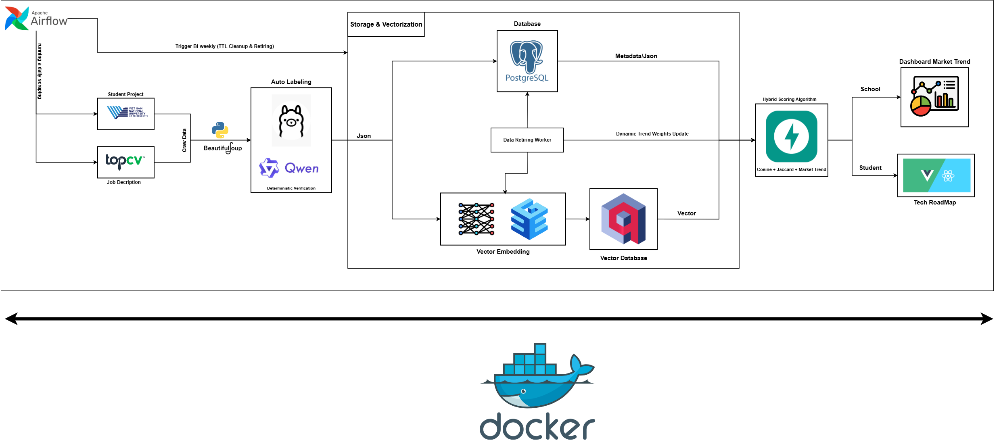
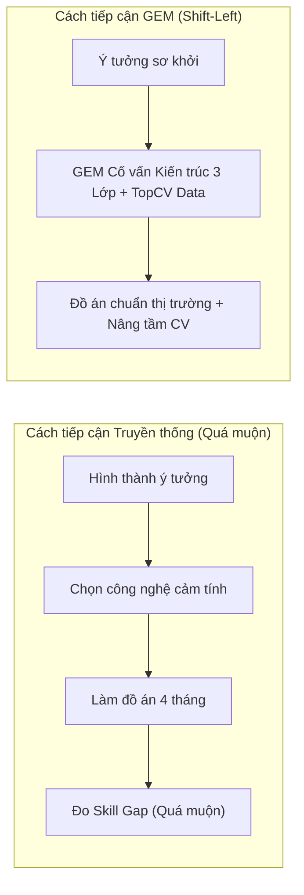
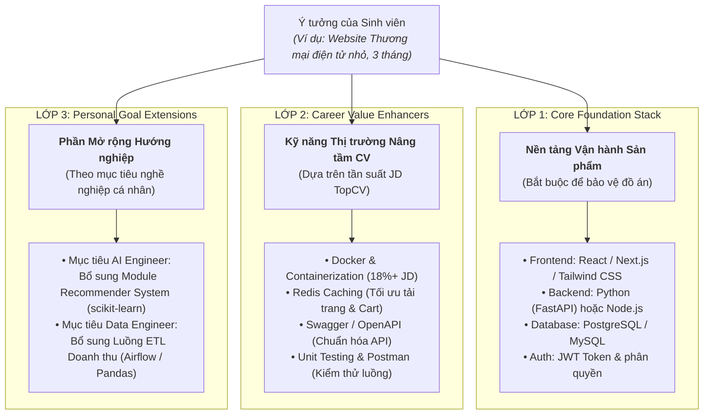
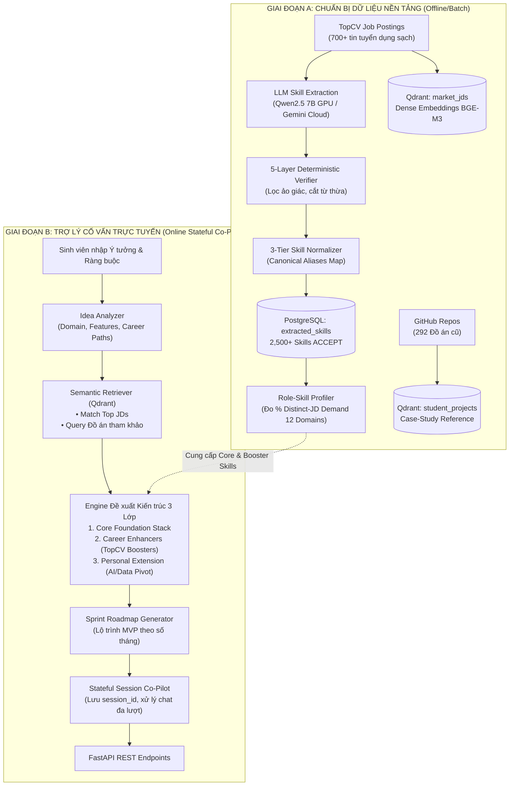

# 💎 GEM (LUSTRA_GEM) — AI Ideation & Career Co-Pilot for IT Students

<p align="center">
  
</p>

<p align="center">
  <b>Nền tảng Cố vấn Ý tưởng Đồ án & Đồng hành Định hướng Nghề nghiệp IT dựa trên Dữ liệu Tuyển dụng Thực tế</b><br>
  <i>AISC 2026 · Track: Data Driven Business · Team LUSTRA · Trường Đại học Công nghệ Thông tin (UIT - ĐHQG-HCM)</i>
</p>

<p align="center">
  
  
  
  
  
  
  
  
</p>

---

## 📌 Mục lục

- [1. Bối cảnh & Triết lý Thiết kế "Shift-Left"](#-1-bối-cảnh--triết-lý-thiết-kế-shift-left)
- [2. Khung Cố vấn Công nghệ 3 Lớp & Trụ cột Cốt lõi](#-2-khung-cố-vấn-công-nghệ-3-lớp--trụ-cột-cốt-lõi)
- [3. Hệ thống Phân tầng Nghề nghiệp Chuyên môn (2-Tier Career Taxonomy)](#-3-hệ-thống-phân-tầng-nghề-nghiệp-chuyên-môn-2-tier-career-taxonomy)
- [4. Kiến trúc Hệ thống & Luồng Dữ liệu End-to-End](#-4-kiến-trúc-hệ-thống--luồng-dữ-liệu-end-to-end)
- [5. Bảng Tiến độ Triển khai Dự án](#-5-bảng-tiến-độ-triển-khai-dự-án)
- [6. Cấu trúc Dự án](#-6-cấu-trúc-dự-án)
- [7. Công nghệ & Hạ tầng](#-7-công-nghệ--hạ-tầng)
- [8. Hướng dẫn Cài đặt & Khởi chạy Toàn diện](#-8-hướng-dẫn-cài-đặt--khởi-chạy-toàn-diện)
- [9. Kịch bản Hội thoại Mẫu Đã Kiểm thử Thành công](#-9-kịch-bản-hội-thoại-mẫu-đã-kiểm-thử-thành-công)
- [10. Đội ngũ Phát triển](#-10-đội-ngũ-phát-triển)

---

## 📖 1. Bối cảnh & Triết lý Thiết kế "Shift-Left"

### 1.1. Nỗi đau thực tế của Sinh viên CNTT khi làm Đồ án
Khi bắt đầu đồ án môn học hoặc khóa luận tốt nghiệp, sinh viên năm 3–4 thường gặp 3 nghịch lý:
1. **Mông lung trong việc lựa chọn Tech Stack:** Có ý tưởng đề tài (như website bán hàng, cổng y tế) nhưng không biết nên chọn ngôn ngữ/framework nào vừa sức với thời gian (3–6 tháng) mà vẫn có giá trị tuyển dụng cao.
2. **Lệch pha kỹ năng với thị trường (Skill Gap):** Sinh viên thường chỉ hoàn thành các tính năng CRUD cơ bản, thiếu hụt các kỹ năng thực chiến mà doanh nghiệp bắt buộc tìm kiếm (Docker containerization, Caching Redis, OpenAPI documentation, Unit Testing, CI/CD).
3. **Bế tắc khi muốn đổi hướng nghề nghiệp (Career Pivot):** Khi muốn hướng tới vị trí chuyên sâu (như AI Engineer, Data Scientist), sinh viên thường có xu hướng bỏ ngang đề tài web để làm một đề tài AI thuần lý thuyết quá sức, dẫn tới rủi ro không hoàn thành được sản phẩm để bảo vệ.

### 1.2. Triết lý "Shift-Left" của GEM
Thay vì là một công cụ đánh giá thụ động ở cuối chu kỳ (chờ sinh viên làm xong đồ án rồi mới chấm điểm/đo khoảng cách kỹ năng), **GEM can thiệp sớm ngay từ ngày đầu tiên khi sinh viên mới hình thành ý tưởng (Shift-Left Career Advisory)**.



### 1.3. Phân định rõ vai trò của 2 nguồn dữ liệu
* **Dữ liệu Tuyển dụng TopCV (Căn cứ thị trường chính):**  
  Là hệ quy chiếu thị trường chuẩn xác, cung cấp bằng chứng thực tế về các kỹ năng, công nghệ và năng lực mà các nhà tuyển dụng thực sự yêu cầu.
* **Kho Đồ án Cũ từ GitHub (Nguồn tham khảo phụ trợ - Case Studies):**  
  Cung cấp ví dụ thực tiễn về cách tổ chức thư mục, phương án triển khai của các nhóm đi trước.  
  > **Nguyên tắc cốt lõi:** GEM **không phụ thuộc** vào dữ liệu đồ án cũ để quyết định xu hướng. Dù kho đồ án cũ ít hoặc chưa có project tương tự, GEM vẫn tự tin tư vấn độc lập dựa trên Chuẩn kiến trúc Công nghệ phần mềm và Bằng chứng nhu cầu thị trường từ TopCV.

---

## 🌟 2. Khung Cố vấn Công nghệ 3 Lớp & Trụ cột Cốt lõi

Để giải quyết bài toán tư vấn vừa đảm bảo sản phẩm hoạt động được, vừa nâng tầm CV, GEM xây dựng **Khung Đề xuất Công nghệ 3 Lớp (3-Layer Technology Framework)**:



### 4 Trụ cột Cố vấn của GEM:
1. **Hiểu ý tưởng tự nhiên:** Bóc tách bài toán, module nghiệp vụ và gợi ý 2–3 hướng nghề nghiệp khả thi.
2. **Tìm kiếm bằng chứng thị trường:** Đối chiếu Qdrant Vector DB và xây hồ sơ kỹ năng theo từng vị trí tuyển dụng thực tế.
3. **Đề xuất Kiến trúc 3 Lớp & Lộ trình Sprint:** Phân bổ kế hoạch MVP theo thời gian (Tháng 1 làm Core Web, Tháng 2 làm Module Hướng nghiệp, Tháng 3 tích hợp & đóng gói).
4. **Hội thoại Đa lượt (Stateful Co-Pilot):** Quản lý trạng thái phiên (`session_id`), cho phép sinh viên chat tiếp để đổi vị trí, đổi thời gian hoặc công nghệ mà không quên ngữ cảnh trước đó.

---

## 🏢 3. Hệ thống Phân tầng Nghề nghiệp Chuyên môn (2-Tier Career Taxonomy)

Để bám sát thực tế thị trường lao động tại Việt Nam, GEM chuẩn hóa hệ thống nghề nghiệp thành cấu trúc phân tầng 2 cấp (**Lĩnh vực Nghề nghiệp $\rightarrow$ Vị trí Chuyên môn**):

| Lĩnh vực lớn (Domain) | Vị trí Chuyên môn Phổ biến (Specific Role) | Kỹ năng Thị trường Cốt lõi (TopCV Core Tech) |
| :--- | :--- | :--- |
| **Software Engineering** | **Backend Developer**<br>**Frontend Developer**<br>**Fullstack Developer**<br>**Mobile Developer**<br>**Blockchain Engineer** | Java, Spring Boot, Python, Node.js, PHP, C#/.NET, PostgreSQL, MySQL<br>ReactJS, VueJS, Angular, TypeScript, Tailwind CSS, HTML/CSS<br>React + Node.js/Python, RESTful API, CSDL quan hệ<br>Flutter, React Native, Android (Kotlin), iOS (Swift)<br>Solidity, Web3.js, Smart Contracts, Ethereum |
| **Artificial Intelligence (AI)** | **AI Engineer**<br>**AI Researcher**<br>**Data Labeling** | Python, LangChain, LangGraph, PyTorch, TensorFlow, scikit-learn, REST API<br>LLM, Computer Vision, NLP, Prompt Engineering, OpenCV<br>Annotation Tools, Data Quality, Quy trình dán nhãn dữ liệu |
| **Data Science & Analytics** | **Data Engineer**<br>**Data Analyst**<br>**Data Scientist** | SQL, Python, Apache Spark, Apache Airflow, ETL Pipeline, BigQuery, Kafka<br>SQL, Power BI, Tableau, Excel, Data Visualization, Business Intelligence<br>Python, R, Machine Learning, Thống kê ứng dụng, pandas, NumPy |
| **Software Testing & QA** | **Automation Tester**<br>**Manual Tester**<br>**QA / QC Engineer** | Selenium, Playwright, Postman API, JMeter, CI/CD, Python/Java Testing<br>Test Case Design, Bug Tracking (Jira), Regression Testing, User Acceptance<br>Quy trình kiểm thử chất lượng phần mềm, ISO, CMMI, Test Plan |
| **IT Infrastructure & Ops** | **DevOps Engineer**<br>**Cloud Engineer**<br>**System Engineer / Admin** | Docker, Kubernetes, CI/CD (GitHub Actions/GitLab), Linux, Terraform, Ansible<br>AWS, Azure, Google Cloud Platform, Cloud Architecture, Serverless<br>Linux OS, Windows Server, Virtualization (VMware), Shell Scripting, Nginx |
| **Information Security** | **Cyber Security Specialist**<br>**AppSec Engineer** | An ninh mạng, Network Security, SIEM, Firewall, SOC, Giám sát sự cố<br>Penetration Testing, OWASP Top 10, Bảo mật ứng dụng, Mã hóa dữ liệu |
| **Product Management** | **Business Analyst (BA)**<br>**Product Owner / PM** | Phân tích nghiệp vụ, Viết User Stories, Vẽ sơ đồ UML/BPMN, Jira, Figma<br>Product Roadmap, Quản lý backlog, Agile/Scrum, Phân tích hành vi |
| **Software Design** | **UI/UX Designer**<br>**Graphic & 3D Designer** | Figma, Wireframing, Prototyping, Design System, Trải nghiệm người dùng<br>Photoshop, Illustrator, 3D Modeler, Animation, Thiết kế đồ họa |
| **IoT & Embedded** | **Embedded Engineer**<br>**IoT Engineer** | C/C++, Vi điều khiển (ARM, STM32, ESP32), RTOS, Giao tiếp UART/I2C/SPI<br>MQTT, Cảm biến, IoT Gateway, Phần cứng nhúng |
| **Game Development** | **Game Developer** | Unity, Unreal Engine, C#, C++, Thiết kế vật lý game, Tối ưu đồ họa |

---

## 🏗️ 4. Kiến trúc Hệ thống & Luồng Dữ liệu End-to-End



---

## ⚡ 5. Bảng Tiến độ Triển khai Dự án

| Giai đoạn (Phase) | Mô tả kỹ thuật | Kết quả & Bằng chứng thực nghiệm | Trạng thái |
|---|---|---|:---:|
| **Phase 0: Infrastructure** | Docker hóa PostgreSQL 15, Qdrant Vector DB, Apache Airflow, FlareSolverr. | Containers chạy ổn định, Ollama local phục vụ GPU CUDA. | ✅ Hoàn thành |
| **Phase 1: Ingestion & Cleaning** | Pipeline thu thập dữ liệu tự động, bóc tách JSON-LD, Unicode NFC, hash dedup. | 700 JDs tuyển dụng TopCV sạch, 292 Đồ án GitHub sạch. | ✅ Hoàn thành |
| **Phase 2: LLM Extraction & Verifier** | Trích xuất kỹ năng bằng Qwen 2.5 7B + Bộ kiểm định tất định 5 lớp loại bỏ ảo giác. | Golden Set 120 tài liệu (F1 ~95%), trích xuất tích lũy **2,515+ skills ACCEPT**. | ✅ Hoàn thành |
| **Phase 3: Normalization & Demand** | Chuẩn hóa Canonical Skill, Alias Map 150+ biến thể, đo lường % Distinct-JD Demand. | Bảng nhu cầu kỹ năng thị trường minh bạch theo từng công nghệ. | ✅ Hoàn thành |
| **Phase 4: Market Profiler & Qdrant** | Phân tầng 12 Lĩnh vực nghề nghiệp, vector hóa BGE-M3 (1024 chiều) vào Qdrant. | `RoleSkillProfiler` & `QdrantVectorService` (collections `market_jds`, `student_projects`). | ✅ Hoàn thành |
| **Phase 5: Stateful Ideation Co-Pilot** | Kiến trúc 3 lớp, chia lộ trình MVP theo thời gian, quản lý phiên hội thoại đa lượt. | `consultant.py`, `backend/app/main.py` test thành công kịch bản 3 lượt chat. | ✅ Hoàn thành |
| **Phase 6: Frontend Web & Presentation** | Giao diện Chat Co-Pilot trực quan, Dashboard Thị trường, Slide báo cáo AISC'26. | Sẵn sàng tích hợp UI cho người dùng cuối. | 🟡 Tiếp theo |

---

## 📂 6. Cấu trúc Dự án

```text
AISC26_LUSTRA_GEM/
├── backend/                                # FastAPI REST API Backend
│   ├── app/
│   │   ├── main.py                         # Điểm khởi động FastAPI & Endpoints
│   │   ├── core/                           # Cấu hình bảo mật, logging
│   │   ├── models/                         # Pydantic & SQLAlchemy Models
│   │   └── services/                       # Tích hợp dịch vụ cố vấn & thị trường
│   └── tests/                              # Unit tests & Integration tests
├── pipeline/                               # Data Engineering & AI Pipelines
│   ├── dags/                               # Airflow DAGs cào dữ liệu định kỳ
│   └── src/gem_pipeline/                   # Mã nguồn nghiệp vụ cốt lõi
│       ├── ingestion/                      # topcv.py & github.py thu thập dữ liệu
│       ├── cleaning/                       # job_cleaner.py & project_cleaner.py
│       ├── extraction/                     # prompts.py, extractor.py, verifier.py
│       ├── golden_set/                     # evaluator.py & công cụ đánh giá nhãn vàng
│       ├── normalization/                  # aliases.py & normalizer.py
│       ├── market/                         # demand.py & role_profiler.py (2-tier taxonomy)
│       ├── vector_store/                   # qdrant_service.py (BGE-M3 + Qdrant)
│       └── recommendation/                 # consultant.py (Stateful Co-Pilot & 3-Layer)
├── frontend/                               # React + TypeScript + Vite Web App
│   └── src/                                # Giao diện Chat Co-Pilot & Dashboard
├── data/                                   # Lưu trữ dữ liệu phân tầng
│   ├── raw/                                # Dữ liệu thô từ TopCV & GitHub
│   ├── processed/                          # Dữ liệu sạch đã qua tiền xử lý
│   └── gold/                               # Golden Set & Annotations benchmark
├── docs/                                   # Tài liệu thuyết minh & thiết kế
│   ├── LUSTRA.pdf                          # Bản thuyết minh đề tài chính thức nộp BTC
│   └── gem_master_project_summary.md       # Báo cáo tổng hợp toàn diện kiến trúc
├── infra/                                  # Hạ tầng triển khai Docker Compose
│   └── docker-compose.yml                  # PostgreSQL, Qdrant, FlareSolverr, Airflow
├── scripts/                                # Scripts thực thi dòng lệnh & batch jobs
│   ├── run_batch_extraction.py             # Chạy trích xuất hàng loạt bằng Qwen local
│   ├── run_cleaning.py                     # Làm sạch toàn bộ kho dữ liệu
│   └── run_extraction_benchmark.py         # Chạy benchmark đối sánh nhãn vàng E1
├── .env.example                            # Mẫu biến môi trường
└── README.md                               # Tài liệu tổng quan dự án (Bản chính)
```

---

## 🛠️ 7. Công nghệ & Hạ tầng

| Thành phần | Công nghệ | Vai trò & Mục đích sử dụng |
| :--- | :--- | :--- |
| **Primary Database** | **PostgreSQL 15 (Docker)** | Lưu trữ dữ liệu thô, dữ liệu sạch (`cleaned_*`) và bảng kỹ năng trích xuất (`extracted_skills`). |
| **Vector Database** | **Qdrant (Docker, Port 6333)** | Lưu trữ dense vectors và thực hiện tìm kiếm ngữ nghĩa theo Cosine Similarity cho JD và Project. |
| **Local LLM Engine** | **Ollama · Qwen 2.5 7B (CUDA)** | Trích xuất thực thể kỹ năng cục bộ trên GPU NVIDIA RTX với độ chính xác cao và chi phí 0đ. |
| **Embedding Model** | **BAAI/bge-m3 (1024 chiều)** | Mô hình nhúng đa ngôn ngữ chuẩn mực mã hóa ngữ nghĩa cho cả tiếng Việt và tiếng Anh. |
| **Cloud Fallback AI** | **Google Gemini 3.5 Flash-Lite / 3.8 Flash** | Dự phòng khi trích xuất khối lượng lớn hoặc khi tài nguyên máy cục bộ bận. |
| **Backend REST API** | **FastAPI, Pydantic, SQLAlchemy** | Cung cấp hệ thống API hiệu năng cao, hỗ trợ hội thoại đa lượt cho giao diện người dùng. |
| **Crawler & Proxy** | **FlareSolverr & Requests** | Vượt rào cản bảo vệ Cloudflare khi thu thập dữ liệu tuyển dụng TopCV. |

---

## 🚀 8. Hướng dẫn Cài đặt & Khởi chạy Toàn diện

### Bước 1: Clone Repository & Tạo Môi trường Ảo
```bash
git clone https://github.com/PoemN-1212/AISC26_LUSTRA_GEM.git
cd AISC26_LUSTRA_GEM

# Khởi tạo môi trường ảo Python 3.11 hoặc 3.12
python -m venv .venv

# Kích hoạt trên Windows PowerShell:
.\.venv\Scripts\Activate.ps1
# Hoặc trên Linux/macOS:
source .venv/bin/activate

# Cài đặt các thư viện cần thiết
pip install -r pipeline/requirements.txt
pip install qdrant-client fastapi uvicorn httpx
```

### Bước 2: Cấu hình Biến Môi trường
Tạo file `.env` từ `.env.example`:
```env
POSTGRES_USER=gem_admin
POSTGRES_PASSWORD=gem_secret_password
POSTGRES_HOST=localhost
POSTGRES_PORT=5432
POSTGRES_DB=gem_database
QDRANT_URL=http://localhost:6333
OLLAMA_URL=http://localhost:11434
GEMINI_API_KEY=your_gemini_api_key_here
```

### Bước 3: Khởi động Hạ tầng Docker
```bash
docker compose up -d
```
Kiểm tra các cổng dịch vụ:
* **PostgreSQL:** `localhost:5432`
* **Qdrant Vector DB:** `localhost:6333/dashboard`

### Bước 4: Khởi động Mô hình AI Cục bộ (Ollama)
```bash
# Tải mô hình Qwen 2.5 và mô hình nhúng BGE-M3
ollama pull qwen2.5:7b
ollama pull bge-m3
```

### Bước 5: Khởi chạy Backend API FastAPI
```bash
python -m uvicorn backend.app.main:app --host 0.0.0.0 --port 8000 --reload
```
Truy cập tài liệu API tự động tại: [http://localhost:8000/docs](http://localhost:8000/docs)

---

## 💬 9. Kịch bản Hội thoại Mẫu Đã Kiểm thử Thành công

Kịch bản thực tế mô phỏng 3 lượt tương tác giữa Sinh viên và GEM:

* **Lượt 1 (Ý tưởng sơ khởi):**
  > **Sinh viên:** *"Tôi muốn làm website thương mại điện tử. Tôi chưa biết nên chọn công nghệ nào."*  
  > **GEM Co-Pilot:** Nhận diện nghiệp vụ cốt lõi (Sản phẩm, giỏ hàng, đơn hàng, thanh toán) ➔ Gợi ý 3 hướng: Fullstack, Backend hoặc AI Engineer ➔ Đề xuất bộ Core Foundation Stack khả thi.
* **Lượt 2 (Pivot mục tiêu sang AI):**
  > **Sinh viên:** *"Nếu tôi muốn hướng tới AI Engineer thì sao?"*  
  > **GEM Co-Pilot:** Cập nhật `target_role = "AI Engineer"`. Giữ nguyên website thương mại điện tử làm nền tảng vận hành ➔ Kích hoạt **Lớp 3 AI Extension: Product Recommendation System (scikit-learn)** ➔ Giải thích giá trị thực tế trong CV khi đi phỏng vấn.
* **Lượt 3 (Ràng buộc 3 tháng & Python):**
  > **Sinh viên:** *"Tôi chỉ có ba tháng và muốn ưu tiên Python, scikit-learn. Có thể làm một phiên bản vừa sức không?"*  
  > **GEM Co-Pilot:** Giữ nguyên các thông tin trước, gọt giũa thành bản **MVP vừa sức 3 tháng**:
  > - **Tháng 1:** Hoàn thiện Web API bằng FastAPI + PostgreSQL + JWT.
  > - **Tháng 2:** Xử lý dữ liệu & xây dựng mô hình Recommender bằng Python + scikit-learn.
  > - **Tháng 3:** Tích hợp API AI vào giao diện Web, đóng gói Docker Compose và viết báo cáo.

---

## 👥 10. Đội ngũ Phát triển

* **Cuộc thi:** AI Solution Challenge 2026 (AISC 2026)  
* **Đơn vị:** Trường Đại học Công nghệ Thông tin — ĐHQG-HCM (UIT)  
* **Khoa:** Hệ thống Thông tin  
* **Nhóm tác giả:** **LUSTRA**

| Thành viên | MSSV | Vai trò chính |
| :--- | :---: | :--- |
| **Lê Vĩnh Thái** | 23521417 | Team Lead · AI Pipeline Architect & System Engineer |
| **Nguyễn Văn Mạnh Huy** | 23520641 | AI Engineer · Model Benchmark & Normalization |
| **Trần Nhụy Tam Tử Phục** | 24521400 | Backend Developer · Data Ingestion & API Integration |
| **Phạm Nhật Khoa** | 23520753 | Frontend Developer · UI/UX & Data Visualization |

---

<p align="center">
  <b>💎 GEM × LUSTRA</b><br>
  <i>Empowering IT Students with Market-Driven Skill Intelligence & Actionable Tech Roadmaps</i>
</p>
